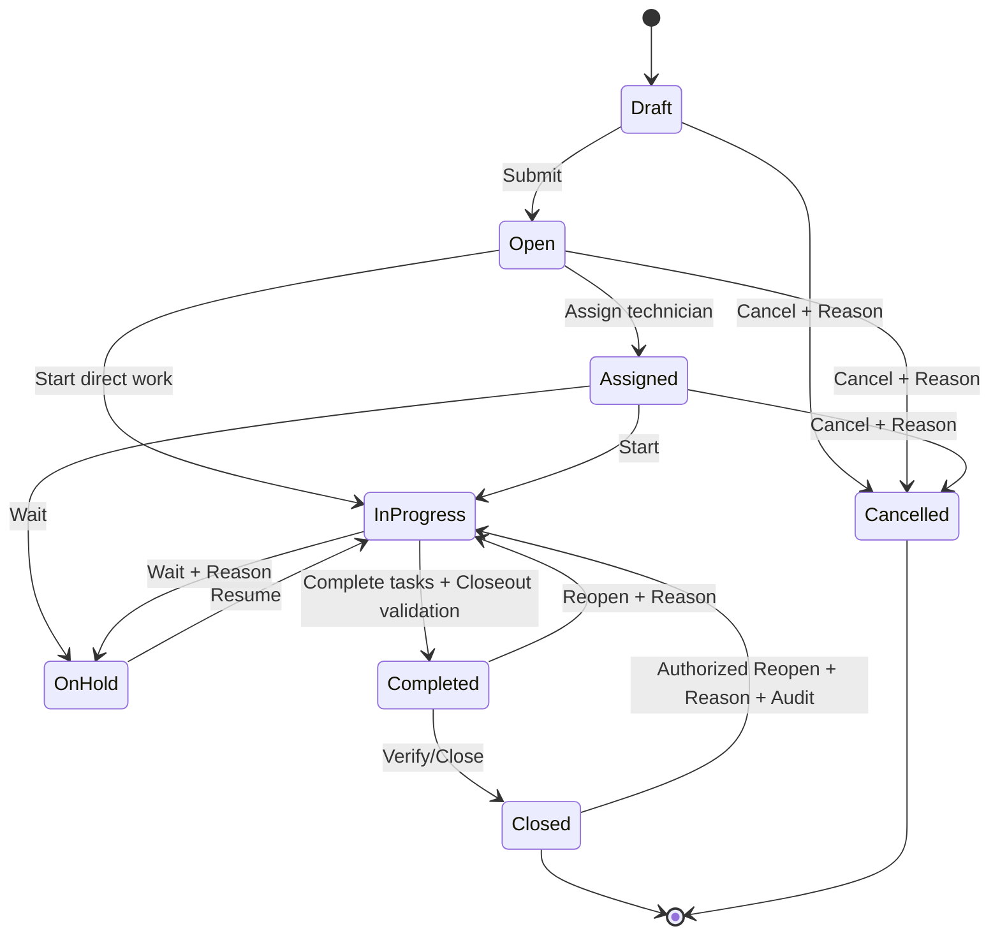
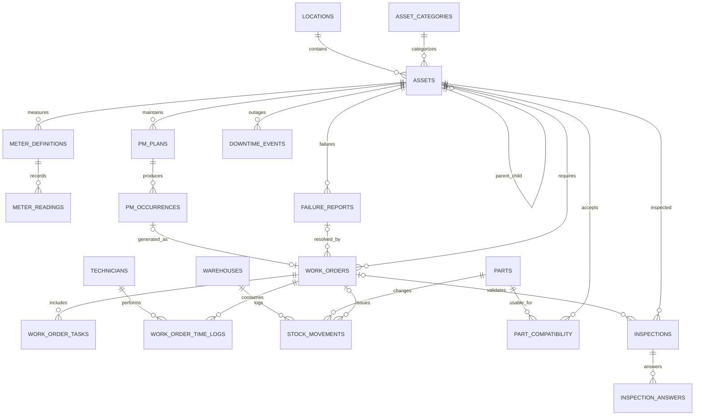
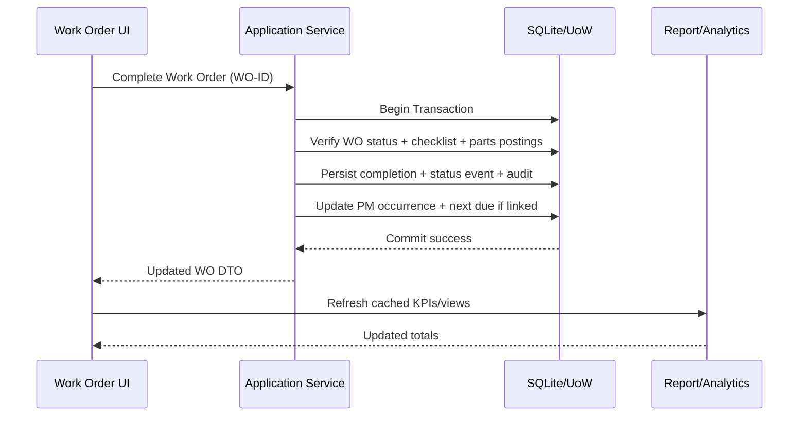

# ENG. IBRAHIM — Maintenance Management System (CMMS)

> **Software Requirements Specification + Technical Design + Implementation Contract**  
> **Version:** 1.1.0 | **Status:** Development Baseline — Revised | **Date:** 2026-10-26  
> **Product Name:** `ENG. IBRAHIM`  
> **Windows executable:** `ENG_IBRAHIM.exe`  
> **Document language:** Arabic (technical names in English where helpful)  
> **Target:** Offline, single-computer Windows desktop application  
> **Primary stack:** Python + PySide6 + SQLite  
> **Purpose of this file:** تسليمه إلى نموذج لغوي/فريق تطوير لتنفيذ التطبيق كاملًا، على مراحل قابلة للاختبار والتسليم، دون تغيير القرارات الأساسية دون مبرر.

---

## 0) تعليمات إلزامية لأي LLM أو فريق يبدأ التنفيذ

1. اقرأ **الوثيقة كاملة** قبل كتابة الكود، واعتبر أقسام **Business Rules / Database / Acceptance Criteria** المرجع الأعلى عند التعارض؛ ثم سجّل التعارض في `docs/DECISIONS.md` ولا تترك سلوكًا غامضًا.
2. نفّذ **تطبيقًا فعليًا يعمل على Windows** وليس Mockup ولا صفحات تجريبية ولا كودًا شكليًا. لا تكتب أزرارًا ظاهرها فعّال وهي لا تعمل.
3. المنتج **Windows-only، جهاز واحد، أوفلاين بالكامل**. ممنوع إضافة متطلبات سيرفر/Cloud/Firebase/اشتراكات/Android/Web أو طلب اتصال بالإنترنت للتشغيل.
4. الواجهة **PySide6 / Qt Widgets**، والتخزين **SQLite** محليًا. يُمنع اختزال التطبيق في ملف Python عملاق، ويجب اتباع تقسيم Layers واضح.
5. الاسم الرسمي الظاهر للمستخدم `ENG. IBRAHIM`، والوصف الثانوي `Maintenance Management System`. ملف التشغيل `ENG_IBRAHIM.exe`، واستخدم أيقونة `assets/icons/ENG_IBRAHIM_Icon.ico` إن كانت مرفقة.
6. العربية والإنجليزية واجهتان مطلوبتان؛ العربية **RTL** والإنجليزية **LTR**، مع لغة افتراضية قابلة للتغيير. النصوص لا تُكتب مبعثرة داخل Widgets؛ بل تمر عبر Localization service.
7. حافظ على سلامة البيانات: معاملات DB، قيود FK وUNIQUE وCHECK، ترحيلات Schema، نسخ احتياطية صحيحة، عدم اختفاء سجلات الصيانة بعد تحديث EXE.
8. قسّم كل مرحلة إلى مهام صغيرة ذات مخرجات فعلية واختبارات. لا تعتبرها مكتملة قبل النجاح في معايير القبول الخاصة بها.
9. أي حقل محسوب أو حالة تلقائية له **معادلة/خوارزمية موثقة** ومصدر بيانات واضح. لا تخترع قيمًا في شاشة Production؛ بيانات العينة اختيارية في وضع DEMO منفصل.
10. أي ميزة موسومة **P0** إلزامية للإصدار الأساسي؛ **P1** امتداد للإصدار 1.x؛ **P2** تحسين مستقبلي. لا تؤخّر إغلاق P0 بمزايا P2.
11. إذا تعذّر استخدام مكتبة أو أسلوب معين في نسخ Qt الحديثة، استبدله بمكافئ مستقر مع الحفاظ على السلوك، ووثّق القرار واعتمادياته ورخصته.
12. في ختام كل مرحلة قدّم: الملفات المتغيرة، كيفية التشغيل، نتائج الاختبارات، صور/وصف الشاشات المكتملة، القيود المعروفة، وما تبقى.
13. لا تحفظ أسرارًا أو كلمات مرور أو Connection Strings في الكود، ولا تنفّذ أوامر Shell ناتجة مباشرة من مدخلات المستخدم.
14. لا تعتبر توقيع الـ EXE رقميًا متاحًا افتراضيًا؛ إن لم تتوفر شهادة توقيع، يجب توضيح احتمال ظهور SmartScreen دون محاولة تعطيل الحماية.
15. التواريخ المالية والإحصائية والتقارير **مترابطة مع البيانات الحقيقية** ولا تُنفذ كصور ثابتة للعرض.

---

## 0.1) سجل مراجعات الإصدار 1.1.0

هذا الإصدار **لا يغيّر قاعدة عمل ولا يوسّع حدود المنتج**؛ يغلق فقط ثغرات كانت ستُترك لتقدير المنفّذ، ويوحّد أسماء الحقول، ويضيف المُدخلات الحسابية الناقصة. كل بند موثّق كـ ADR في `docs/DECISIONS.md`، والنسخة السابقة محفوظة كما هي في `docs/SPEC_v1.0.0.md` للمقارنة.

| # | التغيير | الأقسام | ADR |
|---|---|---|---|
| 1 | Data Root لم يعد مرتبطًا بحساب Windows واحد (نمط `shared_pc` + مؤشر موقع) | 19.2، 19.2.1، 21.1، 21.2، 32 | ADR-001 |
| 2 | إضافة مُدخلات `Availability`: تقويم ساعات تشغيل مجدولة + استثناءات + قاعدة N/A | 16.3، 19.4، 21.2، 28.2 | ADR-002 |
| 3 | `currency_code` على حركات وأرصدة المخزون لمطابقة تقييم WAC | 12.5، 19.4 | ADR-003 |
| 4 | تاب Inspections داخل شاشة أمر الشغل | 10.5 | ADR-004 |
| 5 | استكمال شاشات البيانات المرجعية (أكواد الأعطال، مكتبة المهام، الوحدات، العملات، المخازن) | 3.5، 3.8، 21.2 | ADR-005 |
| 6 | توحيد أسماء الحقول بين النص والـ Data Dictionary + قاعدة تسمية ملزمة | 7.2، 9.2، 19.3.1، 19.4 | ADR-006 |
| 7 | State Machine كجدول انتقالات قابل للتنفيذ (مصدر الحقيقة) لا كرسم فقط | 10.3.1، 20.3 | ADR-007 |
| 8 | تعريف MTTR بأساس افتراضي واحد + إزالة غموض «subtask» | 10.2، 16.1، 35 | ADR-008 |
| 9 | قرار الأرقام العربية-الهندية والتقويم الهجري | 3.7، 21.2، 35 | ADR-009 |
| 10 | تطبيع النص العربي للبحث | 4.5، 19.4، 19.6، 28.2 | ADR-010 |
| 11 | `work_order_part_usage` أصبح View مشتقًا لا جدولًا مخزّنًا | 12.6، 19.4 | ADR-011 |
| 12 | فتح منفذ تجميع التكلفة من Phase 2 قبل وجود المخزون | 20.3، 29 | ADR-012 |
| 13 | نقل إثبات PDF العربي إلى Phase 0 كبوابة خروج | 17.2، 29 | ADR-013 |
| 14 | توصية تقليص نطاق 1.0 (بانتظار قرار المالك، **غير مطبقة**) | 1.4.1 | ADR-014 |

---

## 1) الملخص التنفيذي والرؤية

### 1.1 الهدف

بناء برنامج مكتبي احترافي لإدارة ومتابعة **صيانة الأصول والمعدات بورشة ومحطة معالجة مياه/صرف صحي**، يشمل المضخات والمحركات والبلوارات والمولدات والضواغط والمحابس والمعدات الكهروميكانيكية والسيارات والمعدات المتحركة والأجهزة المساعدة، مع أوامر شغل، صيانة وقائية وتصحيحية، مخزون قطع غيار، تكاليف، مرفقات، وتحليل أداء، وتصدير PDF وExcel.

البرنامج **لا يتحكم** مباشرةً في المعدات، وليس SCADA أو PLC أو BMS، ولا يتصل بالآلات تلقائيًا في الإصدار الأساسي. بيانات ساعات التشغيل والقراءات والأعطال تُدخل يدويًا أو تستورد من Excel وفق قواعد تحقق واضحة.

### 1.2 حالة التشغيل المعتمدة

| البند | قرار نهائي |
|---|---|
| نطاق المستخدم | محطة/ورشة واحدة على كمبيوتر Windows واحد |
| بيئة العمل | أوفلاين بدون إنترنت أو خادم |
| تخزين البيانات | SQLite ملف محلي خارج ملفات البرنامج |
| المستهدف | Windows 10/11 x64 (النسخ المدعومة مع Python/Qt المثبتة) |
| المستخدمون | مستخدم محلي أساسي + حسابات محلية اختيارية على نفس الجهاز |
| الإدخال | واجهة عربية/إنجليزية، فأرة ولوحة مفاتيح، قارئ QR يعمل كلوحة مفاتيح اختياري |
| المخرجات | شاشة، طباعة، PDF، XLSX، CSV للاستيراد عند الحاجة |
| التوزيع | Installer مفضّل + Standalone folder + Onefile EXE بعد اجتياز الاختبارات |
| القاعدة | لا تخزين دائم داخل EXE أو مجلد التثبيت |
| الترخيص/التكلفة | حلول محلية دون رسوم تشغيل إلزامية، والتحقق من تراخيص المكتبات والأصول |

### 1.3 الفئات المستفيدة

- مهندس/مسؤول صيانة: يضيف الأصول، يخطط الصيانة، يراجع الأعطال والمؤشرات.
- مشرف الورشة: يوزع أوامر العمل ويتابع التنفيذ.
- فني: يسجل نتيجة الفحص والأعمال والساعات والقطع المستهلكة (على نفس الكمبيوتر).
- أمين مخزن: يضيف القطع ويتابع حركات الصرف والاسترجاع والرصيد.
- مدير المحطة: يتابع تقارير الأداء والتكلفة والحالة العامة.

هذه **أدوار عمل Business Roles**؛ ليست بالضرورة مستخدمين متزامنين أو أجهزة متعددة. آلية الحسابات والصلاحيات المحلية موضحة لاحقًا.

### 1.4 نطاق وإصدارات التنفيذ

**P0 / MVP كامل ومفيد فعليًا:** التهيئة، البيانات المرجعية، سجل الأصول، السيارات، العدادات، الفحص، الصيانة الوقائية، البلاغات، أوامر الصيانة، الفنيون، المخزن والحركات، البحث، Dashboard، التقارير الأساسية PDF/XLSX، الاستيراد المنضبط، النسخ الاحتياطي، Audit Log، EXE.

**P1 / الإصدار الموسّع:** الموردون، طلبات الشراء المحلية، قوائم فحص متقدمة، خطط ميزانية وتقارير تفصيلية، QR، استيراد تاريخي، قوالب تقارير، تحسينات التحليل ومؤشرات جودة البيانات.

**P2 / خارج الإصدار الأول:** مزامنة عدة أجهزة، تطبيق هاتف، بوابة ويب، SCADA integration، البريد/SMS، Cloud، تنبؤات AI، IoT، نظام محاسبي كامل، مشتريات إلكترونية، جدولة ذكية معقدة. **لا تنفذ هذه الميزات في P0.**

### 1.4.1 توصية تقليص نطاق الإصدار 1.0 — قرار مطلوب من المالك

P0 كما هو مكتوب (٢٢ شاشة + ١٨ تقريرًا + محرك PM + Ledger مخزون + Import + Backup/Restore + Installer) هو نطاق **منتج كامل** لا نطاق MVP، وتقديره الواقعي ٤–٦ أشهر لمطوّر سينيور منفرد. التوصية الهندسية التالية **غير مطبقة على هذه الوثيقة** وبانتظار قرار المالك، وتُسجَّل نتيجتها في `docs/DECISIONS.md` قبل بدء Phase 3:

| داخل 1.0 | مؤجّل إلى 1.1 |
|---|---|
| Assets + العدادات + المواقع/الفئات/الأنواع | قوالب الفحص المتقدمة (`inspection_templates`) |
| PM (Calendar / Meter / Hybrid) + Occurrences | شاشة PM Calendar (UI-012) |
| Work Orders + State Machine + Time Logs | تفاصيل المركبات المتخصصة (إطارات/مستندات/تنبيهات تجديد) |
| المخزون + WAC + تكلفة WO | Import Wizard (يبقى CSV/XLSX استيراد أساسي) |
| 6 تقارير: REP-001, 003, 005, 006, 009, 013 | بقية التقارير حتى REP-018 |
| Backup/Restore + Audit + Settings | المستخدمون/الصلاحيات المتعددة + Notifications Center الكامل |
| Dashboard: 5 بطاقات KPI فقط | الرسوم العشرة (15.2) |

**المبرر:** كل بند مؤجل يعتمد على Schema وServices موجودة، فتأجيله لا يكلّف إعادة كتابة؛ بينما تأخير التسليم يكلّف الثقة والوقت. أي قرار بالإبقاء على النطاق الكامل يجب أن يوثّق تقديرًا زمنيًا صريحًا وقبول المخاطرة.

### 1.5 تعريف النجاح

- تشغيل EXE على جهاز Windows نظيف لا يحتوي على Python، مع عمل كل الوظائف الأساسية.
- تسجيل أصل، جدول صيانة، توليد Work Order، إتمامه، صرف قطع، ظهور أثره في الرصيد والتكاليف، ثم إصدار PDF/XLSX صحيح، دون خطأ أو فقد بيانات.
- غلق التطبيق وإعادة فتحه أو تحديث إصدار التطبيق لا يؤدي إلى فقد البيانات.
- احتساب مؤشرات الأداء من مدخلات موثقة؛ أي نقص بيانات يظهر في الحالة/التقرير بدل إخفائه أو تقديره صامتًا.

---

## 2) المصطلحات والمبادئ

| الاختصار/المصطلح | المعنى | التفسير داخل النظام |
|---|---|---|
| CMMS | Computerized Maintenance Management System | إدارة الصيانة المحوسبة |
| Asset | Equipment/Vehicle/Facility Asset | أي معدة أو سيارة أو أصل يتطلب متابعة |
| PM | Preventive Maintenance | أعمال مجدولة لتجنب الأعطال |
| CM | Corrective Maintenance | أعمال إصلاح بعد عطل أو ملاحظة |
| WO | Work Order | أمر شغل رسمي مرتبط بأصل |
| Breakdown | Failure Event | حدث عطل مسجّل |
| Downtime | Out-of-service Duration | ساعات توقف الأصل عن الوظيفة المطلوبة |
| Runtime | Operating Hours | ساعات تشغيل فعلية مسجلة من عداد أو سجل |
| Odometer | Vehicle Distance | قراءة عداد كيلومترات السيارة |
| MTTR | Mean Time To Repair | متوسط مدة الإصلاح وفق سياسة قياس معلنة |
| MTBF | Mean Time Between Failures | متوسط ساعات التشغيل بين الأعطال للمعدات القابلة للإصلاح |
| Availability | Availability % | نسبة الإتاحة وفق نافذة زمنية وساعات مجدولة وتوقفات موثقة |
| Stock Issue | صرف مخزني | تخصيص/صرف قطعة لأمر شغل أو جهة |
| Stock Return | مرتجع | إعادة كمية مصروفة وفق ربطها بعملية أصلية |
| Audit Log | سجل التتبع | من غيّر ماذا ومتى ومن أي شاشة |
| Soft Delete | أرشفة/تعطيل منطقي | إخفاء سجل دون كسر الروابط التاريخية |

**قواعد عامة:** لا تحذف علاقة تاريخية صحيحة؛ استخدم الأرشفة بدل الحذف عندما توجد معاملات. لا تجمع بين مفاهيم «الحالة الفنية للأصل» و«حالة أمر الشغل». لا تعتبر «الصيانة اكتملت» مساوية تلقائيًا لـ«الأصل عاد للعمل» دون تصريح بذلك.

---

## 3) الهوية البصرية وواجهة المستخدم UX/UI

### 3.1 الهوية

- العلامة الأساسية: **ENG. IBRAHIM**.
- العبارة الفرعية: **Maintenance Management System**.
- شعار ثانوي يمكن استخدامه: **Reliable Equipment · Continuous Operation**.
- فكرة الشعار: الأحرف `EI` مدمجة مع ترس/دافع مضخة/موجة مياه؛ يعكس الصيانة والهندسة ومحطات المعالجة.
- ملفات الأصول المرجعية إن توفرت: `ENG_IBRAHIM_Icon.ico`, `ENG_IBRAHIM_Icon.png`, `ENG_IBRAHIM_Icon.svg`.
- إن لم تكن مرفقة، لا تستبدلها بأيقونة نظام عامة ضمن الإصدار النهائي؛ اكتب `ASSET_NEEDED` واضحًا في التسليم.

### 3.2 Design tokens — اقتراح إلزامي كبداية وقابل للتعديل عبر Themes

| Token | Light | Dark | استخدام |
|---|---|---|---|
| Primary navy | `#11345A` | `#0B1B30` | Sidebar / Headings |
| Primary blue | `#1678D3` | `#2596F3` | Active, Primary Button |
| Teal | `#08A7B4` | `#1DB7C5` | Accent / Pumps / Water |
| Background | `#F4F7FB` | `#101722` | App background |
| Surface | `#FFFFFF` | `#1A2533` | Cards / Panels |
| Text primary | `#162B43` | `#F0F5FA` | Labels / Tables |
| Text secondary | `#68798A` | `#B1BDCA` | Hints |
| Success | `#1EA86B` | `#35BE82` | Completed / Healthy |
| Warning | `#F3A120` | `#FFB545` | Due Soon / Hold |
| Danger | `#E04752` | `#FA6370` | Overdue / Critical |
| Border | `#E1E7EF` | `#2A394B` | Dividers |

- Typography: خطوط مرخّصة ومدمجة داعمة للعربية والإنجليزية، مثل `Noto Sans Arabic` و`Inter` وفق الترخيص؛ استخدم البديل المناسب إن تعذر التغليف. لا تنشر ملف خط غير مرخّص.
- Scale: 8px spacing system (4/8/12/16/24/32)، Rounded cards 10–14px، أزرار بارتفاع 36–42px، جدول بأطوال صفوف 38–44px، أيقونات موحّدة 18–22px.
- أي حالات بالألوان يجب أن تُكتب **أيضًا نصيًا** (`Overdue`، `Completed`...) ولا تعتمد على اللون فقط.
- دعم التباين الواضح والـ Keyboard Focus، لا تستخدم رموزًا غامضة دون Tooltip.

### 3.3 بنية الشاشة الرئيسية

```text
┌────────────────────────────────────────────────────────────────────────┐
│ ENG. IBRAHIM  | Search (Ctrl+K)   | Notification  | Theme | Settings   │
├───────────────────────┬────────────────────────────────────────────────┤
│ Sidebar               │ Breadcrumb / Page Title / Primary Actions      │
│  • Dashboard          │                                                │
│  • Assets             │  KPI Cards / Charts / Data Table / Forms       │
│  • Work Orders        │                                                │
│  • Preventive Maint.  │  Filters / Search / Export / Printing          │
│  • Corrective Maint.  │                                                │
│  • Vehicles Workshop  │                                                │
│  • Checklists         │                                                │
│  • Spare Parts        │                                                │
│  • Technicians        │                                                │
│  • Reports            │                                                │
│  • Settings           │                                                │
├───────────────────────┴────────────────────────────────────────────────┤
│ Status Bar: Local DB OK | Last Backup | Current Profile | App Version │
└────────────────────────────────────────────────────────────────────────┘
```

### 3.4 سلوك واجهات كل الأقسام

- Sidebar ثابتة/قابلة للطي؛ الصفحة الحالية تظهر بوضوح؛ Dashboard هي الصفحة الافتراضية.
- Header فيه بحث عام `Ctrl+K`، إجراءات سريعة `New WO`, `Add Asset`, `Issue Part`, `Generate Report`، والإشعارات والإعدادات.
- Tables: sort/filter/search/pagination or virtualization حسب الحجم؛ لا تُحمّل آلاف الملفات/الصور دفعة واحدة؛ اختيار صف + عرض تفصيلي؛ سياق إجراءات وأوامر مفهومة.
- Forms: Tabs/Groups/Validation Inline، بيان الحقول المطلوبة `*`، زر Save / Save & New / Cancel، منع الإدخال المكرر، تحذير عند الخروج من نموذج غير محفوظ.
- Dates: اختيار Calendar + إدخال من لوحة المفاتيح، عرض التاريخ حسب إعداد التطبيق، التخزين القياسي موحّد.
- أرقام: إظهار وحدة القياس؛ استخدام Decimal عند تكلفة المال، وقيم عشرية واضحة للقراءآت.
- ملفات: Drag & Drop للمرفقات إن أمكن، إظهار الحجم والامتداد والاسم والمسار المنطقي.
- Tables empty-state: رسائل توجيهية فيها إجراء؛ loading/processing state؛ error-state مع «تفاصيل تقنية» قابلة للنسخ؛ success-state بعد الحفظ الحقيقي.
- RTL: عكس اتجاه القوائم والـ layout في العربية، لكن **الأكواد، Serial Numbers، ملفات المسارات، المعادلات، الوحدات** تظل مقروءة باتجاه LTR داخل حاويات مناسبة.
- Light/Dark toggle، تذكّر العرض، لا يجب أن تختفي البيانات في وضع تغيير اللون.
- أي عمليات ثقيلة (Excel/PDF/Import/Backup) تتم عبر `QThreadPool`/Workers وتحديث progress من Signals دون وصول مباشر للـ Widgets من Worker.
- Window: حجم مبدئي 1440×900 مع حد أدنى عملي (مثل 1100×700)، يتكيف على دقات Full HD و1366×768 مع Scroll مناسب؛ يتذكر آخر حجم وموضع شريطة أن يبقى على شاشة متاحة.

### 3.5 القائمة الرئيسية ومصفوفة الشاشات

| Screen ID | Name | وظيفة أساسية | أولوية |
|---|---|---|---|
| UI-001 | First Run Wizard | تهيئة اسم المحطة والمستخدم والإعدادات | P0 |
| UI-002 | Dashboard | النظرة التنفيذية والمؤشرات والإشعارات | P0 |
| UI-003 | Assets List | فهرس الأصول والفلاتر والتصدير | P0 |
| UI-004 | Asset Profile | تفاصيل أصل + Tabs + تاريخ كامل | P0 |
| UI-005 | Asset Form | إنشاء/تعديل أصل | P0 |
| UI-006 | Meter Readings | ساعات تشغيل/كم/قراءات فنية | P0 |
| UI-007 | Vehicles Workshop | السيارات وصيانتها | P0 |
| UI-008 | Failure Reports | تسجيل الأعطال والملاحظات | P0 |
| UI-009 | Work Orders | قائمة الأوامر وحالاتها | P0 |
| UI-010 | Work Order Editor | مهام وفنيون وقطع وتكاليف وإغلاق | P0 |
| UI-011 | PM Plans | الخطط والجدولة والتوليد | P0 |
| UI-012 | PM Calendar | عرض الصيانات حسب الزمن | P0 |
| UI-013 | Inspection Forms | الفحص ونتائج البنود | P0 |
| UI-014 | Spare Parts Catalog | تعريف قطع الغيار والكميات | P0 |
| UI-015 | Stock Transactions | استلام/صرف/مرتجع/تسوية | P0 |
| UI-016 | Technicians | بيانات الفنيين وساعات العمل | P0 |
| UI-017 | Reports Center | القوالب والفلاتر والتصدير | P0 |
| UI-018 | Notifications | مستحق/متأخر/نقص مخزون | P0 |
| UI-019 | Master Data | تابات: المواقع/الفئات/الأنواع/أكواد الأعطال/مكتبة المهام/الوحدات/العملات/المخازن/تقاويم التشغيل (راجع 3.8) | P0 |
| UI-020 | Settings | اللغة والوحدات والعملة والنسخ والأمان | P0 |
| UI-021 | Data Import Wizard | Excel import preview/mapping/errors | P0 |
| UI-022 | Audit Log | سجل المراجعة التاريخي | P0 |
| UI-023 | QR Printing | طباعة ملصقات رموز الأصول | P1 |
| UI-024 | Suppliers / Purchasing | الموردون وطلبات الشراء | P1 |
| UI-025 | Templates Designer | تخصيص قوالب التقرير والفحص | P1 |

### 3.6 اختصارات لوحة المفاتيح

- `Ctrl+K` بحث عام؛ `Ctrl+N` إنشاء أمر عمل (من أي شاشة مناسبة)؛ `Ctrl+S` حفظ النموذج؛ `Ctrl+P` طباعة/معاينة؛ `Ctrl+E` تصدير الشاشة إن أمكن؛ `F5` تحديث البيانات؛ `Esc` إغلاق Modal/إلغاء؛ `Ctrl+L` اختيار لغة الواجهة إن لم يتعارض مع عنصر آخر.
- يجب منع الاختصار عند وجود نافذة تأكيد أو عملية مهمة مفتوحة بما يسبب حفظًا غير مقصود.

---

### 3.7 اللغة والأرقام والتقويم (Locale Rules)

هذه القواعد تمنع ثلاثة أعطال متكررة في الواجهات العربية: أرقام مبعثرة، تواريخ مقلوبة، وأكواد تنكسر داخل نص RTL.

- **الأرقام:** الافتراضي **Latin digits (`0-9`)** في كل الشاشات والتقارير والملفات المصدرة. الخيار `numerals = latin | arabic_indic` يخص **النصوص الوصفية فقط**، ولا يُطبّق أبدًا على: `asset_code`, `part_code`, `wo_number`, `serial_number`, `VIN`, `plate_number`, أسماء الملفات، الوحدات، أو أي قيمة تُصدَّر إلى Excel/CSV. المبرر: خلط الأرقام العربية-الهندية مع أكواد لاتينية داخل جدول واحد يُنتج تبادل اتجاه (bidi) صعب التشخيص ويُحرّف النسخ واللصق.
- **الفواصل:** فاصل الآلاف والعلامة العشرية يُشتقان من `locale` العرض فقط؛ **التخزين** يبقى `Decimal`/`minor units` بلا فواصل (راجع 19.3). القيم المصدرة إلى Excel تُكتب أرقامًا خامّة مع `number_format`، لا كنص منسّق.
- **التقويم:** ميلادي فقط في P0. بداية الأسبوع إعداد صريح (`sunday` افتراضيًا للعربية، `monday` للإنجليزية)، لا استنتاج ضمني. عرض هجري استشاري **P1** ولا يدخل في أي حساب استحقاق أو تقرير رسمي.
- **الوقت:** التواريخ الزمنية UTC في التخزين والعرض محلي (19.3). مواعيد PM اليومية تُخزَّن `Date` محليًا وتُقارن بـ `local_today`، لا بـ UTC.
- **الاتجاه:** لا تُحفظ محارف تحكم اتجاه (RLM/LRM) في قاعدة البيانات؛ تُطبَّق في طبقة العرض فقط. اسم الأصل والقطعة يُخزَّن كما كتبه المستخدم.

**قبول:** تغيير لغة الواجهة لا يغيّر أي قيمة مخزنة، ولا يقلب أي كود أو تاريخ في الشاشة أو في PDF/Excel.

### 3.8 الشاشات المرجعية المطلوبة للبيانات الأساسية

القسم 4 يفرض CRUD لكل قائمة مرجعية، والشاشات التالية تغطيها فعليًا (تابات داخل UI-019 ما لم يُذكر غير ذلك):

| المرجع | الشاشة | ملاحظات |
|---|---|---|
| Locations (Hierarchy) | UI-019 / Tab Locations | منع الحذف عند وجود أصول فعّالة |
| Asset Categories / Types | UI-019 / Tab Categories | `spec_schema_json` لكل نوع |
| Failure Codes (category + mode + root cause) | UI-019 / Tab Failure Codes | مجموعات ثابتة قابلة للتوسعة |
| Maintenance Task Library | UI-019 / Tab Task Library | إعادة استخدام في PM وInspection |
| Units | UI-019 / Tab Units | كود ثابت + `precision` |
| Currencies | UI-019 / Tab Currencies | تُقفل بعد أول حركة مالية |
| Warehouses | UI-019 / Tab Warehouses | مخزن رئيسي افتراضي |
| Operating Calendars | UI-019 / Tab Calendars | راجع 16.3 و19.4-C |

لا شاشة منفصلة لكل مرجع في P0؛ تاب واحد لكل مجموعة مع نفس نمط الجدول والتحقق، ومنع الأرشفة عند وجود ارتباطات.

---

## 4) بنية البيانات المرجعية Master Data

قبل تسجيل الأصول يجب توفير شاشات CRUD للأقسام/المواقع/الأنواع والتصنيفات الأساسية. كل قائمة تدعم اسم عربي وإنجليزي وكودًا وحالة نشط/مؤرشف، وترتيب العرض.

### 4.1 Locations / Hierarchy

- `Plant → Area → System → Location` Hierarchy مثال: `Treatment Plant / Pump Station / Sludge Pumps / Room A`.
- يمكن أن تكون المنطقة قسم ورشة/جراج/مخزن/مبنى الكهرباء/حوض تهوية/محطة رفع.
- الأصل يتبع Location واحدًا نشطًا، مع إمكانية نقله وحفظ سجل النقل (من/إلى/التاريخ/السبب).
- تحذير عند تعطيل موقع يحتوي على أصول فعالة؛ لا حذف لموقع مرتبط بسجلات.

### 4.2 Asset Categories / Types

تصنيفات ابتدائية قابلة للتعديل: Pumps, Motors, Blowers, Air Compressors, Generators, Vehicles, Heavy Equipment, Gearboxes, Valves, Screens, Mixers, Dosing Pumps, Electrical Panels, Instruments, HVAC, Cranes, Other.

لكل نوع: وصف واختيارات حقول فنية. لا تفرض نفس الحقول على كل أصل؛ يوجد Base asset + Specifications JSON validated or typed detail profiles (راجع قاعدة البيانات).

### 4.3 Failure Codes & Maintenance Task Library

- Failure category: Mechanical, Electrical, Instrumentation, Hydraulic, Operational, Wear, Leakage, Other.
- Failure Mode: Seal failure, Bearing failure, Overheating, Excessive vibration, Cavitation suspect, Motor trip, Oil leak, Corrosion, Clogging, Tire puncture, Brake failure، إلخ.
- Root Cause: Incorrect lubrication, misalignment, material wear, foreign objects, inadequate operation, unknown (لا تُجبر المستخدم على سبب غير محقق).
- Standard maintenance task library: task code, title, procedure text, expected duration, safety flags, optional consumables, acceptance criteria.

### 4.4 Units & Currency

- حفظ كود/وحدة مستقلة لكل قياس: `h`, `km`, `°C`, `mm/s RMS`, `bar`, `m³/h`, `A`, `V`, `L`, `pcs`, `kg`.
- لا تخلط تحويل وحدات غير متماثلة؛ عند تغيير وحدة عرض، يتم تحويل القيم وفق قاعدة معرفة دون تغيير الأصل التاريخي خارج معاملة مقصودة.
- العملة الافتراضية قابلة للاختيار (مثل SAR أو EGP)، يجب تثبيت عملة السجل المالي تاريخيًا ولا تغيير قيمه بمجرد تغيير إعداد العملة. تحويل العملات خارج P0.

---

### 4.5 تطبيع النص العربي للبحث (Arabic Search Normalization)

البحث بالكود يبقى مطابقًا حرفيًا (trim + case-insensitive). البحث بالاسم يحتاج تطبيعًا، وإلا فشل في أكثر الحالات شيوعًا: `مضخه` لا تجد `مضخة`، و`احمد` لا تجد `أحمد`.

**قواعد التطبيع** — تُطبَّق على طرفي المقارنة فقط، ولا تُغيّر النص المخزَّن:

1. إزالة التشكيل والتطويل (`ـ` وحركات الضبط).
2. توحيد الألف: `أ إ آ ٱ` → `ا`.
3. `ى` → `ي`، و`ة` → `ه`، و`ؤ` → `و`، و`ئ` → `ي`.
4. تحويل الأرقام العربية-الهندية إلى لاتينية داخل نص البحث.
5. تصغير الحروف اللاتينية، وتوحيد المسافات المتعددة، وحذف المسافات الطرفية.
6. **لا تُحذف** `ال` التعريف: حذفها يُنتج تصادمات دلالية أكثر مما يحل (يبقى مع stemming حقيقي في P2).

**التنفيذ:** عمود ظل `search_norm` (TEXT, `COLLATE NOCASE`) محسوب في طبقة التطبيق عند كل إنشاء/تعديل وحذف منطقي، على `assets`, `parts`, `locations`, `asset_categories`, `technicians`, `failure_codes`, مع فهرس. البحث يستخدم `search_norm LIKE '%normalize(query)%'`. **لا Trigger في SQLite** لأن منطق التطبيع يجب أن يبقى واحدًا ومختبرًا في Python.

**قبول:** نتائج البحث متطابقة بين الشاشة والتقرير والتصدير؛ البحث لا يُرجع سجلات مؤرشفة إلا بتفعيل Include Archived؛ والتطبيع لا يُطبَّق على الأكواد ولا على الأرقام المرسلة.

---

## 5) إدارة المعدات والأصول Assets Register

### 5.1 حقول تعريف الأصل

| الحقل (Data key) | مطلوب؟ | نوع/قاعدة |
|---|---|---|
| `asset_code` | نعم | كود فريد غير قابل للتكرار (مثال `PMP-001`) |
| `asset_name_ar` | نعم | اسم عربي مناسب |
| `asset_name_en` | اختياري | اسم إنجليزي |
| `asset_category_id` | نعم | Lookup |
| `asset_type_id` | اختياري | Lookup متوافق مع الفئة |
| `location_id` | نعم | Location مفعل |
| `parent_asset_id` | اختياري | Parent/Child؛ لا حلقات Hierarchy |
| `manufacturer`, `model`, `serial_number` | اختياري | نصوص مع بحث، Serial قد لا يكون فريدًا على مستوى العالم |
| `commissioning_date`, `purchase_date` | اختياري | تواريخ |
| `purchase_cost`, `replacement_cost` | اختياري | Decimal موجب + Currency |
| `warranty_expiry` | اختياري | تاريخ |
| `criticality` | نعم | Critical / High / Medium / Low؛ افتراضي Medium |
| `asset_condition` | نعم | Excellent / Good / Fair / Poor / Unassessed |
| `operational_status` | نعم | In Service / Standby / Out of Service / Under Maintenance / Retired |
| `maintenance_strategy` | نعم | PM / CM / Both / Run-to-Failure |
| `meter_type` | اختياري | Runtime Hours / Kilometer / Cycle / None |
| `default_meter_unit` | اختياري | h / km / cycles |
| `operating_calendar_id` | اختياري | مرجع تقويم ساعات التشغيل المجدولة؛ بدونه `Availability = N/A` (راجع 16.3) |
| `notes` | اختياري | Rich/plain validated text |
| `photo_attachment_id` | اختياري | صورة رئيسية |
| `is_active`, `archived_at` | نظام | Soft-delete semantics |
| `created_at`, `updated_at`, `created_by` | نظام | Audit metadata |

### 5.2 البيانات الفنية المتخصصة حسب نوع الأصل

- **Pump:** نوع المضخة (centrifugal/submersible/positive displacement)، الخدمة (raw water, sewage, sludge, chemical)، Rated Flow `m³/h`، Rated Head `m`، Rated Speed `rpm`، Motor Power `kW`، Suction/Discharge Size `mm`، impeller diameter، bearing، seal type، efficiency optional؛ كل قيمة + unit.
- **Electric Motor:** Rated power `kW`، voltage `V`، current `A`، phase، frequency `Hz`، speed `rpm`، insulation class، IP rating، bearing refs، starter/VFD.
- **Blower/Compressor:** Type، pressure، flow، power، rpm، oil type، filters، operating temperature ranges إن توفرت.
- **Generator:** kVA/kW، fuel، rated voltage، engine/make، engine hours، oil quantity، filters، battery.
- **Vehicle:** plate no., fleet code, VIN/chassis, brand/model/year, vehicle class, fuel, registration/insurance dates, current odometer, next service odometer، wheel/tire details optional.
- **Valve:** nominal size، pressure rating، actuation (manual/electric/pneumatic)، material، valve type، actuator info.
- **Instrument:** Tag، measured variable، measurement range، accuracy، calibration interval/date (P1 for advanced calibration tracking).
- لا تفرض حقولًا عامة مثل `flow` على سيارات أو `odometer` على محابس؛ اعرض النماذج الديناميكية بحسب الفئة.

### 5.3 شاشة الأصل (Asset Profile)

**Header:** صورة، Code، الاسم، الحالة التشغيلية، الخطورة، الموقع، اختصارات `New WO`, `New Reading`, `Plan PM`, `View History`, `Print Asset Card`.

**Tabs:** Overview، Technical Details، Meter & Readings، PM Plans، Work Orders، Failures/Downtime، Parts Used، Costs، Documents/Photos، Audit/Movement History.

قوائم الفرز: category/location/status/criticality/warranty/maintenance due، مع بحث بالاسم/الكود/الرقم المسلسل/رقم اللوحة. عمليات bulk: Export Selected، Change location with log، Archive with warning فقط، لا حذف جبري لسجلات التشغيل.

### 5.4 قاعدة الأصل المركب

مثال مضخة لها محرك: `PMP-101` parent و`MTR-101` child، ويمكن إعداد خطة PM لأي منهما. لا تجمع وقت توقف المحرك والمضخة مرتين في KPI على مستوى System ما لم تُحدد سياسة تجميع واضحة؛ Dashboard يعرض مؤشرات الأصول المنفردة افتراضيًا.

### 5.5 قواعد التحقق والقبول

- `asset_code` فريد (case-insensitive بعد trim) ولا يُعاد استخدامه بسهولة بعد الأرشفة.
- منع Parent = Self ومنع دورات Parent Hierarchy.
- الاسم، الموقع، الفئة موجودون؛ الأسعار/القدرات والقراءات لا تقبل سالبًا حيث لا معنى له.
- نقل الموقع لا يمحو سجل مواقع سابقًا.
- إيقاف الأصل أو إحالته للخردة لا يمحو WO أو التكاليف أو التاريخ.
- عند الأرشفة: لا يُولّد له PM جديد ويظهر في التاريخ عبر خيار Include Archived.

---

## 6) السيارات وورشة المركبات Fleet/Workshop

### 6.1 بيانات المركبة

المركبة نوع Asset لكن لها ملف متخصص: `fleet_code` و`plate_number` و`VIN` و`make` و`model` و`year` و`fuel_type` و`odometer_unit` و`engine_hours` اختياري و`department` و`assigned_driver` (اسم وظيفي فقط) و`insurance_expiry` و`registration_expiry` و`maintenance_contact` و`notes`.

### 6.2 الأعمال الدورية المتاحة

تغيير زيت المحرك/الفلاتر، زيت الفتيس، الفرامل، سيور المحرك، التبريد، البطارية، الإطارات، ميزان وزوايا، تكييف، فحص شامل، فحص/تجديد مستندات، صيانة حسب الكيلومترات أو المدة أو ساعات التشغيل.

### 6.3 قواعد خاصة بالورشة

- تسجيل قراءة جديدة للعداد مع التاريخ والمصدر؛ لا تُقبل قراءة أقل من آخر قراءة لنفس العداد زمنيًا إلا من خلال عملية `Meter Correction` مبررة ومسجّلة دون إعادة كتابة التاريخ بصمت.
- برنامج صيانة سيارة مثل `Every 10,000 km OR every 6 months`؛ نوع السياسة موثق ويستحق عند تحقق **أول** شرط (`whichever comes first`).
- عند إدخال العداد، يظهر Due/Overdue فورًا حسب قواعد Scheduler، ويمكن توليد WO من الخطة.
- الأوامر تقبل تكلفة زيت/فلتر/قطع/عمالة وأجرة ورشة خارجية.
- تاريخ كل سيارة: الأعمال السابقة مع km/date، أعطال متكررة، متوسط تكلفة/كم فقط إذا توفرت مسافة حقيقية موجبة ونافذة قياس محددة.
- مفاهيم `Vehicle Unavailable` و`Workshop Time` لا تُعتبر واحدة تلقائيًا؛ يسجل فترة خروج الخدمة بوضوح.

### 6.4 نموذج خدمة سيارة

```text
Vehicle: TRK-002 | Plate: XYZ-123 | Odometer: 78,560 km
Service: Engine oil and filter
Plan: Every 10,000 km OR 6 months
Last completed: 70,000 km on 2026-05-10
Next thresholds: 80,000 km / 2026-11-10
Status: Due Soon according to configured warning thresholds
Required parts: Engine Oil 8 L, Oil Filter 1 pc
```

البيانات أعلاه **مثال توضيحي فقط** وليست بيانات إنتاج يجب إضافتها للمستخدم.

---

## 7) العدادات والقراءات الفنية Meters & Measurements

### 7.1 نوعان مختلفان

1. **Cumulative counters:** ساعات تشغيل، كيلومترات، عدد دورات. لا تنخفض عادةً، مع آلية تصحيح/إعادة ضبط موثّقة.
2. **Condition measurements:** حرارة، اهتزاز، ضغط، تيار، عزل، مستوى زيت، تدفق. هذه قد ترتفع/تنخفض بصورة طبيعية؛ لا تشترط monotonic.

### 7.2 حقول القراءة

`asset_id, meter_id, value_decimal, unit, reading_at, entered_at, source(manual/imported), notes, recorder_user_id, correction_of_id(optional), quality_status(valid/suspect/rejected)`.

> الاسم المعتمد للعمود هو `meter_id` (مفتاح `meter_definitions`). أي كتابة `meter_definition_id` في الكود أو التقارير تُعد خطأ تسمية (راجع 19.3.1).

### 7.3 قواعد

- القراءة لها تاريخ حدوث مستقل عن تاريخ إدخالها.
- لا تسمح بكتابة عشوائية للعداد المرجعي؛ التعديل يتم بإضافة Correction Event مع السبب والمراجعة.
- القراءة المتأخرة (Backdated) مسموحة بشروط، وتعيد تقييم الاستحقاق بطريقة متسقة دون تغيير WO تاريخي مغلق تلقائيًا.
- استخراج اتجاهات Chart لكل قياس ومدة؛ مع توضيح أن التحذيرات الفنية لا تُفسر بوصفها حدودًا معيارية عالمية ما لم يدخل مهندس المحطة حدودًا معتمدة.
- Thresholds اختيارية لكل أصل/Measurement، وواضحة الوحدة والجهة/المستخدم الذي اعتمدها.

---

## 8) بلاغات الأعطال Corrective / Breakdown

### 8.1 واجهة البلاغ

الحقول: `failure_no` تلقائي، asset، observed_at، reported_at، reported_by، symptom/details، breakdown mode، failure category، priority، immediate action، machine stopped?، safety impact?، attached photos، status (New/Investigating/Converted/Resolved/Cancelled)، optional confirmed root cause، downtime link.

### 8.2 مسار البلاغ

`New → Triaged → [Converted to WO] → Resolved`، أو `Cancelled` مع السبب. يمكن إنشاء WO واحد رئيسي من البلاغ وربط WO إضافي إن لزم؛ لا يتم تكرار نفس الحدث في إحصاء الأعطال بمجرد وجود أمرين مرتبطين به.

### 8.3 مستوى الأولوية

- `Critical`: سلامة/بيئة/توقف خدمة حرجة؛ يتطلب توضيح الإجراء العاجل.
- `High`: خطر توقف رئيسي أو فقد كبير في الأداء.
- `Medium`: إصلاح مطلوب دون توقف كلي فوري.
- `Low`: خلل طفيف/تحسين.

الأولويات **تصنيف تشغيلي** وليست إعفاءً من إجراءات التصاريح/العزل والأمان.

### 8.4 Downtime

سجل مستقل: `asset_id, failure_id(optional), work_order_id(optional), started_at, ended_at, downtime_type(unplanned/planned/external), affected_function, reason, approved_by`.

- لا تقبل `ended_at < started_at`.
- لا تُجمع فترات توقف متداخلة لنفس الأصل مرتين في نفس Window؛ استخدم Union of Intervals عند حساب ساعات التوقف.
- إغلاق WO لا يملأ تلقائيًا تاريخ عودة المعدة؛ اسأل المستخدم إذا كان الأصل عاد للخدمة، وإذا أكد يمكن تسجيل `ended_at` مع سبب.
- التوقف الناجم عن نقص قطع أو انتظار مشرف يُسجّل On Hold reason وقد يُحتسب في Downtime حسب الواقع وليس حسب حالة أمر العمل وحدها.

---

## 9) الصيانة الوقائية Preventive Maintenance (PM)

### 9.1 الهدف

تعريف خطة صيانة وقائية **لكل أصل** أو لفئة يتم إسنادها صراحةً إلى أصول متعددة، وفق التاريخ أو عداد التشغيل/المسافة، وتوليد أوامر عمل مع قوائم مهام وقطع مقترحة، ثم متابعة تنفيذها وإعادة جدولة الاستحقاق التالي.

### 9.2 حقول خطة الصيانة

| Field | Description |
|---|---|
| `plan_code` | كود فريد مثل `PM-PMP-101-01` |
| `asset_id` | الأصل الذي تطبَّق عليه الخطة (أو تنشأ نسخة لكل أصل عند تطبيق template) |
| `title`, `description` | العنوان والوصف |
| `strategy` | Calendar / Meter / Hybrid |
| `trigger_policy` | DATE_ONLY / METER_ONLY / FIRST_DUE / BOTH_REQUIRED — الأخيرة P1 |
| `calendar_interval_value`, `calendar_interval_unit` | مدة التاريخ + وحدتها (`days`/`weeks`/`months`/`years`)؛ مطلوبة عند strategy = Calendar أو Hybrid |
| `meter_interval_value` | مدة العداد عند strategy = Meter أو Hybrid؛ الوحدة تُشتق من `meter_id` ولا تُخزّن مكررة |
| `base_date` | أساس حساب الاستحقاقات |
| `base_meter_value` | أساس الحساب للعداد |
| `last_completion_at` | آخر تنفيذ مكتمل مؤهل |
| `last_completion_meter` | قراءة العداد وقت إتمام آخر PM |
| `next_due_date` | الاستحقاق المقبل وفق سياسة التاريخ |
| `next_due_meter` | حد العداد التالي |
| `warning_days` | عدد الأيام قبل الاستحقاق (افتراضي قابل للضبط مثل 7) |
| `warning_meter_units` | الإنذار المبكر (مثلاً 100 km أو 20 h) |
| `lead_days` | كم يومًا قبل الاستحقاق يمكن إنشاء WO |
| `criticality`, `estimated_duration_min` | أولويّة التنفيذ والتقدير |
| `status` | Active / Paused / Archived |
| `assignment_hint` | الفني أو فريق التنفيذ الافتراضي |
| `safety_instructions` | تنبيهات إجراء/عزل (ليست تصريح عمل مُعتمد) |
| `version`, `created_at`, `updated_at` | المراجعات |

### 9.3 تعريف الاستحقاق والتنبؤ

- `DATE_ONLY`: يستحق إذا `local_today >= next_due_date`.
- `METER_ONLY`: يستحق إذا `latest_valid_meter >= next_due_meter`.
- `FIRST_DUE`: يستحق عند تحقق **أي** من شرط التاريخ أو العداد؛ هذا مناسب لحالات (كل 6 أشهر أو 10000 كم، أيهما أسبق).
- `warning_date` يبدأ إذا `today >= next_due_date - warning_days` قبل موعد الاستحقاق.
- `warning_meter` إذا `latest_meter >= next_due_meter - warning_meter_units`.
- `OVERDUE` للوقت عندما يتجاوز **اليوم التالي** تاريخ الاستحقاق (إذا اليوم = due فهو DUE)؛ للعداد إذا زادت القراءة على threshold. لا تستخدم زمنًا غير مسجل لتقدير استهلاك عداد.
- حالات العرض: `Not Due`, `Due Soon`, `Due`, `Overdue`, `Blocked/Paused`, `No Valid Meter`, `Awaiting Completion`؛ الحالة محسوبة من الخطة والعداد وحالة WO.
- تاريخ شهري من يوم 31: سياسة ثابتة `CLAMP_TO_LAST_DAY` (فبراير آخر يوم، وهكذا) ومكتوبة في الإعدادات. لا تراكم الانزلاق غير المقصود شهرًا بعد شهر.
- عند حساب next-due بعد إنجاز PM: السياسة الافتراضية **From Completion** (آخر إتمام + الفترة)، وخيار **From Fixed Baseline** للمواعيد الثابتة؛ اختيار السياسة ضروري ولا يغيّره النظام صامتًا.
- حالات الـ P0 تفترض فترة واحدة لكل Plan. عند حاجة أعمال متعددة بمواعيد مختلفة، أنشئ خططًا منفصلة بدل قائمة مهام بفترات مختلفة داخل Plan واحد.

### 9.4 آلية Scheduler عند فتح البرنامج وخلال الاستخدام

1. تحميل الخطط النشطة والأصول غير المؤرشفة.
2. جلب آخر قراءة صالحة لكل Counter.
3. إعادة تقييم due/warning لكل خطة؛ لا تعمل عمليات كتابة عند حساب حالة للعرض فقط.
4. التحقق من وجود occurrence فعال لنفس الاستحقاق قبل إنشاء WO.
5. توليد WO من template يدويًا بضغط `Generate Work Order` أو تلقائيًا عند فتح البرنامج/مرة يوميًا وفق `auto_generate_enabled` مع نافذة `lead_days`.
6. إنشاء `plan_occurrence` بمفتاح فريد مشتق من `plan_id + due anchor` داخل transaction، وربطه بـ WO (Unique) لمنع التكرار.
7. بعد إتمام WO المرتبط بالخطة وتأكيد استيفاء checklist، يسجل completion event؛ ثم يعاد حساب next-due وفق سياسة الخطة.
8. إذا فات أكثر من موعد أثناء توقف التطبيق، لا تُصدر عشرات أوامر شغل صامتة: تظهر `Missed Occurrences` وتطبق سياسة `catch_up_policy` الافتراضية `LATEST_ONLY_AND_LOG_SKIPPED` مع سجل تخطي الأسباب؛ خيار إصدار كل الفوائت P1.
9. إذا كانت خطة `Paused` أو أصل `Retired/Archived` فلا تولد WO تلقائيًا؛ تحفظ السجلات السابقة.
10. إذا كان WO لنفس occurrence ما زال مفتوحًا، يظهر `Awaiting Completion` ولا يتكرر إنشاؤه.

### 9.5 مهام PM Template

لكل بند: sequence، الوصف، تعليمات السلامة، estimated_minutes، required?، `response_type` (Done/Not Done/Not Applicable أو Numeric/Text/Pass-Fail)، min/max **إذا وضعتها الجهة الهندسية**، photo_required?، default_part_requirements.

أمثلة: فحص تسريب mechanical seal، صوت البلي، vibration reading، motor insulation test، grease، تنظيف filter، اختبار starter، مستوى الزيت، تغيير فلتر سيارة. مع الإشارة إلى أن القيم الفنية والمعايير تأتي من manuals أو سياسة الموقع ولا تُفترض بوصفها كودًا هندسيًا عامًا.

### 9.6 حالات خاصة

- تحديث خطة قائمة لا يغير بصمت التوقيت أو محتوى WO المولد بالفعل؛ سجل نسخة template المعتمدة وقت الإنشاء (Snapshot).
- عند إلغاء WO الخاص بـ PM، يسأل هل إعادة فتح/إعادة جدولة occurrence أم اعتباره Skip، مع إلزام سبب.
- `Skip PM` يتطلب سببًا وتاريخًا ومستخدمًا، ولا يُسجل كصيانة مكتملة ولا يرفع مؤشرات الالتزام على أنه نجاح.
- إذا أدخل المستخدم قراءة قديمة تؤثر في due، لا تعدّل أوامر Closed؛ تظهر مراجعة مستقبلية عند الحاجة.

### 9.7 معايير القبول

- خطة 30 يومًا تُصبح مستحقة عند موعدها، ويظهر تحذيرها قبل ذلك حسب `warning_days`.
- خطة `10,000 km OR 6 months` تستحق بمجرد تحقق أحد الشرطين.
- تكرار الضغط على Generate أو فتح البرنامج عدة مرات لا يكرر WO لنفس occurrence.
- تنفيذ الخطة يحدّث Next Due دون فقد التاريخ ويظهر في أصلها وفي تقارير PM Compliance.
- الخطة المتوقفة لا تولد أوامر تلقائية.

---

## 10) أوامر الشغل Work Orders — قلب النظام

### 10.1 أنواع أوامر الشغل

- `PM` Preventive Maintenance.
- `CM` Corrective Maintenance.
- `INSPECTION` Planned inspection.
- `OTHER` تحسينات/خدمة عامة موثقة.

### 10.2 بيانات أمر الشغل

| Group | Required/Optional fields |
|---|---|
| Identity | `wo_number` فريد تسلسلي مع السنة/كود القسم؛ `type`, `title`, `asset_id` (required) |
| Links | `failure_id`, `pm_plan_id`, `plan_occurrence_id`, `parent_work_order_id` (اختياري، بلا حلقات) |
| Scheduling | `requested_at`, `scheduled_start`, `due_at`, estimated_duration_minutes |
| Execution | `actual_start_at`, `actual_end_at`, assigned_technician_id/team, status, progress_pct |
| Priority | Critical / High / Medium / Low |
| Content | problem_description, scope_of_work, safety_notes, task_list, checklists |
| Actual work | labor_entries, part_issues, external_costs, findings, root_cause, action_taken |
| Approvals | `completed_by`, `completed_at`, `closed_by`, `closed_at` (حسب الدور المحلي) |
| Closeout | quality_verification, equipment_returned_to_service, closeout_notes |
| Evidence | photos, documents, attached invoices/receipts (إن سمحت السياسة) |
| Audit | created_by, updated_by, timestamps, status history |

### 10.3 State machine إلزامية



التعريفات:

- **Draft:** مسودة لم تُعتمد تشغيليًا؛ يمكن تعديل معظم الحقول.
- **Open:** أمر صادر ينتظر بدء التنفيذ أو الإسناد.
- **Assigned:** تم تحديد المنفّذ لكنه لم يبدأ بعد.
- **In Progress:** بدأ العمل وسُجل `actual_start_at` مرة واحدة مبدئيًا؛ الجلسات عبر Time Logs.
- **On Hold:** توقف إداري/تشغيلي مع سبب ووقت بداية/نهاية.
- **Completed:** تم تنفيذ المهام وتسجيل نتيجة العمل؛ لا يعني بالضرورة أن الأصل عاد للخدمة أو اعتماد المدير.
- **Closed:** المراجعة النهائية؛ الحالة النهائية المعتادة. يمكن إعادة الفتح بصلاحية وسبب فقط.
- **Cancelled:** إلغاء مع سبب، لا يعني أن العمل تم.

### 10.3.1 جدول الانتقالات الملزم (Single Source of Truth)

هذا الجدول هو المرجع؛ الرسم أعلاه توضيح بصري فقط. مصدر التنفيذ هو `domain/policies/wo_state_machine.py`، والاختبارات تُولَّد منه آليًا. **لا يُضاف انتقال خارج هذا الجدول إلا بقرار موثّق في `docs/DECISIONS.md`.**

| # | From | To | Guard (شرط إضافي) | حقول إلزامية | أدنى صلاحية |
|---|---|---|---|---|---|
| 1 | Draft | Open | الأصل والوصف والأولوية موجودة | `asset_id`, `title`, `priority`, `requested_at` | Maintenance Engineer |
| 2 | Draft | Cancelled | — | `status_event.reason` | Maintenance Engineer |
| 3 | Open | Assigned | فني نشط (`technicians.is_active = 1`) | `assigned_technician_id`, `assigned_at` | Maintenance Engineer |
| 4 | Open | InProgress | بدء مباشر مسموح دون إسناد | `actual_start_at` | Maintenance Engineer |
| 5 | Open | Cancelled | — | `status_event.reason` | Maintenance Engineer |
| 6 | Assigned | InProgress | — | `actual_start_at` | Maintenance Engineer |
| 7 | Assigned | OnHold | — | `status_event.reason` (بداية فترة Hold تُشتق من `changed_at`) | Maintenance Engineer |
| 8 | Assigned | Cancelled | — | `status_event.reason` | Maintenance Engineer |
| 9 | InProgress | OnHold | — | `status_event.reason` (بداية فترة Hold تُشتق من `changed_at`) | Maintenance Engineer |
| 10 | OnHold | InProgress | — | نهاية فترة Hold تُشتق من `changed_at` | Maintenance Engineer |
| 11 | InProgress | Completed | كل البنود المطلوبة مجابة + `equipment_returned_to_service` محدد + لا حجز مخزني معلّق بلا قرار | `actual_end_at`, `completed_at`, `completed_by` | Maintenance Engineer |
| 12 | Completed | Closed | تحقق مسؤول + `closeout_notes` عند وجود استثناء | `closed_at`, `closed_by` | Admin |
| 13 | Completed | InProgress | إعادة فتح | `status_event.reason` | Admin |
| 14 | Closed | InProgress | إعادة فتح مصرّح بها | `status_event.reason` | Admin |

**قواعد عامة:**

- `status_event.reason` هو العمود الوحيد لأسباب الإلغاء/الإيقاف/إعادة الفتح؛ لا تُضاف أعمدة `cancel_reason`/`hold_reason` منفصلة.
- أي انتقال غير موجود في الجدول يُرفض برسالة تحمل الحالة الحالية والمطلوبة وقائمة الانتقالات المتاحة منها.
- `Closed` للقراءة فقط خارج الانتقال 14؛ ولا تُعدَّل تكلفة أو حركة مخزون منشورة داخله.
- كل انتقال يُنفَّذ في Transaction واحدة مع `work_order_status_events` و`audit_logs`.
- الاختباران T-013 و T-051 يُشتقان من هذا الجدول؛ أي صف جديد يولّد حالة اختبار جديدة تلقائيًا.

### 10.4 شروط الانتقال

> جدول 10.3.1 هو المصدر الملزم الوحيد. هذا القسم شرح توضيحي لما يعنيه كل شرط، ولا يُنشئ شروطًا إضافية ولا يُسقط شروطًا.

- Draft → Open: وجود الأصل والوصف والأولوية وتاريخ الطلب.
- Open → Assigned: اختيار فني نشط.
- In Progress → Completed: الإجابة عن جميع البنود المطلوبة، تسجيل نتيجة التنفيذ، معالجة نواقص البيانات الإلزامية، تحديد حالة إعادة الأصل للخدمة (`Yes/No/Not Applicable`)، وعدم وجود صرف مخزني معلق غير مُعالج يحتاج تأكيدًا.
- Completed → Closed: تحقق مسؤول/مستخدم مخوّل، توفير `closeout_notes` لو وُجد استثناء، وحفظ فترة توقف فعلي إن وُجد.
- إلغاء أمر به صرف مواد: لا يُرجع المواد تلقائيًا؛ يبدأ Workflow للتعامل مع المصروف (Consumed أو Returned) حتى لا يصبح الرصيد خاطئًا.
- أمر Closed يصبح للقراءة فقط مع إمكانية `Reopen` موثقة؛ لا تعدّل تكلفة/قطع حركة منشورة مباشرة، بل أنشئ قيد تعديل/مرتجع/Adjustment مع Audit.

### 10.5 تبويبات شاشة أمر الشغل

1. Summary: نوع وأصل وحالة وPriority وموعد وتعيين.
2. Tasks & Checklist: بنود، مسؤول البند، نتائج، ملاحظات، صور.
3. Inspections: قوائم الفحص المرتبطة بالأمر (`inspections.wo_id`)، النتائج والقراءات والمرفقات، والانتقال إلى إنشاء Failure Report عند فشل بند حرج — بموافقة صريحة لا تلقائيًا (راجع 11.2).
4. Time Logs: بدء/إيقاف جلسات عمل، زمن ساعات الفنيين، صافي الوقت.
5. Spare Parts: مقترح/محجوز/مصروف/مرتجع/مستهلك، الكمية والتكلفة.
6. Downtime: الفترة الفعلية والسبب والتأثير.
7. Expenses: تكاليف خارجية/نقل/إصلاح خارج الورشة.
8. Findings & RCA: سبب العطل والاختبارات والإجراء قبل/بعد.
9. Attachments: كتالوج/صورة/ملف.
10. History: كل تغيّر حالة أو حقول حساسة مع المستخدم والتاريخ.

### 10.6 توزيع الفنيين وتسجيل الوقت

- فني أساسي لكل WO ويمكن إضافة مساعدين متعددين عبر `work_order_assignments`.
- Time Entry: technician، started_at، ended_at، `minutes` محسوبة، نوع العمل `Work/Travel/Waiting`، hourly_rate snapshot عند حساب الأجرة، notes.
- منع نهاية قبل بداية؛ منع إدخال ساعات سالبة؛ التحذير من جلسات متداخلة **لنفس الفني** ويمكن منعها P0 ما لم يسمح المشرف بمبرر.
- الانتظار قد لا يدخل في Labor Cost أو MTTR بنفس الطريقة؛ كل تقرير يذكر تعريفه.
- الفواتير الخارجية `expense_type, supplier, amount, tax_included?`؛ المرحلة الأولى لا تنفذ محاسبة ضريبية معقدة، وتعرض المبلغ كتكلفة مسجلة.

### 10.7 تكلفة أمر العمل

\[
WO\ Cost = \sum (Issued\ Parts\ Net\ Cost) + \sum (Labor\ Hours \times Rate\ Snapshot) + \sum (External\ Expenses)
\]

- **Net Parts** = قيمة القطع المصروفة التي لم تُرد/تُلغَ، وفق سياسة تكلفة مخزون موثقة.
- لا تُحسب القطع المقترحة أو المحجوزة **تكلفة مستهلكة** قبل حدوث صرف فعلي.
- يحفظ سعر القطعة وقت الصرف `unit_cost_snapshot` لضمان ثبات التاريخ حتى لو تغير سعر الكتالوج لاحقًا.
- التكاليف تُعرض بعملة الإعداد الفعلية المخزنة مع الحدث؛ إذا وُجدت عملات مختلفة، لا تجمعها دون تحويل موثق (حظر P0).

### 10.8 ترقيم الأوامر

اقتراح `WO-2026-000001`، بلاغ عطل `BR-2026-000001`، خطة `PM-000001`، حركة مخزن `STK-2026-000001`.

- توليد الأرقام داخل SQLite Transaction باستخدام sequence table، لا `MAX()+1` خارج معاملة.
- رقم كودي مستقل عن Internal Primary Key؛ لا يعاد ترقيم المعاملات المنشورة.

### 10.9 القبول

- WO يُحفظ ويظهر في أصل/فني/تقارير الفترة المناسبة.
- انتقال حالة غير مسموح يرفض مع رسالة واضحة.
- مصروف المخزن المربوط بالـ WO يظهر بالتكلفة الصحيحة ولا يمكن خصمه مرتين.
- إنهاء عمل ثم إغلاقه وإعادة فتحه (مع سبب) يحفظ كامل history.
- لا توجد تغييرات على الرصيد/تكلفة WO بمجرد فتح شاشة أو تعديل ComboBox دون Save/Commit.

---

## 11) قوائم الفحص Inspections & Checklists

### 11.1 تعريف القوالب

`inspection_template` متصل بنوع أصل أو أصل محدد، وله version وعناصر مرتبة وقابلة للتفعيل. Forms تنشأ مستقلة أو جزءًا من WO / PM.

أنواع البند: Yes/No، Pass/Fail، Done/N.A.، Numeric، Text، Dropdown محددة، Photo with Comment. لكل عنصر: label Arabic/English، required، `unit`، value bounds اختيارية ومدخلة بواسطة جهة العمل، instruction، photos required، fail_action.

### 11.2 التنفيذ

- Header: asset، inspector، inspection_at، type، template version.
- حفظ النتائج كبنود مستقلة، مع القيمة والوحدة وملاحظات ومرفقات.
- إذا عنصر Critical Failed: يظهر Banner، ويُعرض إنشاء Failure Report / WO مرتبط، ولا يُولّد بلاغ صامتًا من غير إقرار.
- `Complete inspection` يتطلب بنودًا Required، ويقفل البيانات الأصلية مع إمكانية إنشاء Revision مبررة.
- تصدير Checklist PDF بتوقيع/اسم الفني ونتائج كل بند؛ عند الطباعة لا تفقد RTL.

### 11.3 مثال لمضخة

- صوت غير طبيعي: Pass/Fail.
- تسرب من Mechanical Seal: Yes/No + comment.
- قراءة الاهتزاز: Decimal `mm/s RMS` مع نطاق مقبول **يُضبط للمعدة من مرجعها الفني**.
- حرارة Bearing: `°C`.
- حالة ربط المسامير وقاعدة المضخة: Done/Not Done.
- نظافة Strainer: Done/Not Done.

> التطبيق يوثّق أعمال الفحص ولا يضع تلقائيًا «حدود تشغيل آمنة» عامة أو يدّعي أن رقمًا ما مطابق لمعيار فني دون اعتماد المستخدم.

---

## 12) مخزون قطع الغيار Spare Parts & Inventory

### 12.1 المبدأ

مخزون محلي موثّق يعتمد **دفتر حركات Ledger** وليس تعديل خانة `quantity` مباشرة. كل تحديث للرصيد له نوع حركة، ومصدر، ومستخدم، وتاريخ، ومرجع، وتكلفة. يتعامل مع مخزن واحد افتراضي في P0 مع قابلية تعريف مخازن متعددة محليًا إذا لزم.

### 12.2 كتالوج القطع

| Field | Meaning |
|---|---|
| `part_code` | كود فريد مثل `BRG-6205` |
| `part_name_ar`, `part_name_en` | الاسم |
| `category_id`, `description` | فئة وتفاصيل |
| `manufacturer`, `manufacturer_part_no` | الشركة/رقم القطعة |
| `compatible_asset_ids` | علاقة many-to-many لتحديد ملاءمة القطعة للأصول |
| `unit` | pcs / L / kg / m / set (الوحدة الرئيسية) |
| `min_stock`, `reorder_point`, `target_stock` | إنذارات وإعادة طلب |
| `reference_unit_cost`, `currency` | سعر مرجعي، وليس قيمة تاريخية مصروفة |
| `default_supplier_id` | اختياري P1 |
| `bin_location`, `barcode`, `photo` | التخزين/رمز/صورة |
| `is_active` | فعال/مؤرشف |

### 12.3 أنواع الحركات

- `OPENING_BALANCE` افتتاحي (مرة لكل قطعة/مخزن مع ضوابط).
- `RECEIPT` استلام كمية جديدة (كمية موجبة وتكلفة إدخال).
- `ISSUE_TO_WO` صرف إلى أمر شغل.
- `ISSUE_OTHER` صرف لقسم/غرض غير WO بمبرر.
- `RETURN_FROM_WO` مرتجع مرتبط بالصرف الأصلي.
- `ADJUSTMENT_POSITIVE`, `ADJUSTMENT_NEGATIVE` تسوية مع سبب.
- `TRANSFER_OUT`, `TRANSFER_IN` بين مخزنين إن فُعّل أكثر من واحد؛ داخل Transaction واحدة.
- `SCRAP` إهلاك مخزني مع سبب/مرجع.

### 12.4 نموذج الحفظ

- كل حركة `posted` غير قابلة للحذف/التعديل المباشر؛ التصحيح يتم بحركة **Reversal** مرتبطة بالحركة السابقة، مع عدم السماح بصرف كمية أكبر من الرصيد المتاح.
- `balance(part, warehouse) = Σ signed_quantity(base_unit)` للحركات المنشورة.
- من أجل الأداء يمكن تخزين `stock_balance_cache` ويجب تحديثه داخل **نفس Transaction**، وإتاحة إعادة احتسابه ومقارنته بالدفتر.
- `available = on_hand - reserved`، بشرط ألا تكون هناك Reserving معلقًا تفوق الموجود. الحجز لا ينقص On-Hand، والصرف الحقيقي هو الذي ينقصه.
- لا يُسمح بمخزون سالب **افتراضيًا**. أي تجاوز استثنائي ممنوع في P0.
- حركة مرتجع مرتبطة بـ `original_issue_movement_id`، وإجمالي المرتجعات لا يتجاوز كمية الصرف السابق.
- كميات البنود يجب أن تكون موجبة وتلتزم `quantity_precision` طبقًا لوحدة المادة (مثلاً pcs عدد صحيح، L يمكن 3 خانات عشرية).

### 12.5 تقييم تكلفة المخزون (Policy: Weighted Average Cost)

**التقييم المقترح في P0:** المتوسط المرجّح المتحرك لكل `(Part, Warehouse, Currency)`.

استلام كمية `Q_new` بتكلفة وحدة `C_new` فوق رصيد سابق `Q_old` وقيمة `V_old`:

\[
AverageCost_{after} = \frac{V_{old}+Q_{new}\cdot C_{new}}{Q_{old}+Q_{new}}
\]

- إذا كان الرصيد قبل الاستلام صفرًا، المتوسط = سعر الاستلام.
- الصرف يأخذ سعر `average_cost_snapshot` وقت الصرف؛ ويخفض المخزون بالقيمة المقابلة.
- المرتجع من WO يُسجَّل بالقيمة الأصلية وقت الصرف، ثم يضاف إلى قيمة المخزون بالطريقة المحددة بما يحافظ على الدفتر.
- يجب استخدام `Decimal` في Python والتخزين في SQLite كوحدات نقدية مصغرة integer (`amount_minor_units`) حيث يمكن، أو نص Decimal دقيق؛ **لا تستخدم Binary Float لتجميع المال**.
- سياسة إدخال رصيد افتتاحي تتطلب تكلفة ابتدائية، وإلا يظهر `valuation_incomplete` ويُمنع تقرير قيمة مخزون مضلل.
- **العملة جزء من هوية التقييم:** كل حركة تحمل `currency_code`، وكل رصيد `(part, warehouse)` يحمل عملة واحدة ثابتة. استلام بعملة مختلفة عن عملة الرصيد **يُرفض صريحًا** برسالة تطلب تسوية منفصلة؛ لا تحويل عملات صامت ولا رصيد بعملتين في P0.
- لا يسمح بتغيير العملة الأساسية أثناء وجود مخزون مالي منشور دون أداة تحويل محاسبي منفصلة (خارج P0).

### 12.6 مخزن ↔ أوامر شغل

1. إضافة جزء إلى WO كبند **مطلوب Proposed**، أو Reservation فعلي.
2. تحديد الكمية/المخزن.
3. تنفيذ Issue transaction والتحقق من الرصيد والكمية.
4. إنشاء `stock_movement` + `wo_part_usage` داخل Transaction واحدة.
5. تكلفة WO تعرض قيمة الصرف الصافي، ويظهر الرصيد المحدث فورًا.
6. عند إرجاع غير المستخدم: Return transaction linked original issue، وليس إضافة Receipt عامة.
7. إنهاء WO يتطلب تسوية الحجوزات أو توثيق بقائها/إلغائها.

> `work_order_part_usage` ليست جدول حالة: هي **View/Query مشتق** من `stock_movements` المنشورة + المرتجعات المرتبطة بها (`net_quantity = Σ issue − Σ return`)، تُحسب عند الطلب. تخزينها كجدول قابل للكتابة بجانب Ledger غير قابل للتغيير يخلق مصدرين للحقيقة، وهو ممنوع.

### 12.7 الحد الأدنى والتنبيهات

- `Low Stock` إذا `available <= reorder_point` أو `on_hand < min_stock` وفق نوع التنبيه المعروض؛ كلا الحدين مفصولان بوضوح.
- `Out of Stock` إذا `available <= 0`.
- `Suggested reorder quantity = max(target_stock - available, 0)` إن كان Target مضبوظًا؛ هذه **كمية مقترحة** لا Purchase Order تلقائي.

### 12.8 شاشات المخزون

- Catalog (Code/Name/Type/Stock/Unit/Cost/Status) مع Excel import/export.
- Part Profile (Compatibility / Suppliers P1 / Transactions / Cost / Attachments).
- New Receipt / New Issue / Return / Adjustment / Stock Card.
- Stock Balance By Warehouse، Low Stock، Valuation، Consumption by Asset/WO.
- تأكيد صريح قبل ترحيل الحركة؛ Draft مسموح لكن لا يؤثر على الرصيد قبل `Post`.

### 12.9 قبول وظيفي دقيق

مثال اختبار مؤتمت: رصيد افتتاحي `10 pcs × 100`، استلام `10 pcs × 200` → المتوسط `150`، صرف `4 pcs` لعمليّة WO بتكلفة `600`، مرتجع `1 pc` مرتبط بالصرف بقيمة `150` → صافي صرف `3 pcs` بقيمة `450`، On-hand `17 pcs` إن لم توجد معاملات أخرى، مع مطابقة دفتر الحركة والنقدية. لا يسمح بصرف `18 pcs` في هذه اللحظة.

---

## 13) الفنيون، الورش، الموارد والتكلفة

### 13.1 الفنيون

`technician_code, full_name, trade(Mechanical/Electrical/Instrumentation/Vehicle/General), department, phone(optional), qualification(optional), hourly_rate(optional), currency, status, notes`.

- الفني ليس بالضرورة مستخدم تسجيل دخول؛ بل قد يكون مجرد اسم يقوم مهندس بتسجيل أعماله.
- الفئات/الحرف قابلة للإضافة، وحالة Inactive تمنع Assignment الجديد دون حذف التاريخ.
- تقارير Hours per technician، Assigned WOs، Completion time، Labor cost، Workload.

### 13.2 إدارة العمالة والتكاليف

- بيانات تكلفة العمالة تحفظ snapshot في Time Log؛ إذا لم تدخل hourly rate، يكون `Labor Cost = Unknown / Not Provided` وليس صفرًا مؤكدًا.
- تمييز قيمة صفر مُدخل صراحة من قيمة NULL (غير معروفة).
- لا تقيس كفاءة الفني بطريقة تلقائية مضللة بناءً على عدد الأوامر فقط؛ عرض ساعات ونوع الصيانة والمهام والسياق.
- نوع التكلفة: Spare Parts / Labor / External Repair / Transport / Other، مع خيار Budget Code P1.

### 13.3 التكاليف حسب الأصل

`Asset Maintenance Cost = sum(eligible WO costs by asset and period)` مع سياسة معلنة: استخدام تاريخ **posting** للتكلفة عند تقارير الإنفاق، أو تاريخ إغلاق WO عند تقرير تكلفة أوامر مكتملة. يجب ألا يختلط الاثنان داخل نفس تقرير دون توضيح.

---

## 14) الإشعارات والتنبيهات المحلية

### 14.1 مصادر التنبيه

- PM Due Soon / PM Due / PM Overdue.
- Open High/Critical Work Orders تجاوزت Due Date.
- Equipment Unavailable لفترة تتجاوز Threshold يحدده المستخدم.
- Low Stock/Out of Stock.
- Warranty/Vehicle Registration/Insurance expiry (تذكير محلي اختياري).
- Backup Overdue (مثلاً أكثر من 7 أيام منذ نجاح آخر نسخة).
- Import Failure / Missing Critical Data.

### 14.2 UX وموعد الفحص

- Notifications Center مع Severity، النص، مصدر الرابط، `created_at`, `read_at`, `dismissed_at`، وفلاتر.
- تحديث داخل التطبيق عند Launch، وعقب عمليات حفظ ذات صلة، وبفاصل زمني محدود أثناء عمل التطبيق (مثلاً كل 15 دقيقة).
- لأن التطبيق **أوفلاين وليس خدمة Windows دائمة**، الإشعارات/الجدولة لا يُضمن تشغيلها والتطبيق مغلق؛ تُحتسب/تُنفّذ عند التشغيل التالي. لا تدّع إرسال push notification أثناء الإغلاق.
- Toast داخل التطبيق مع اختصار فتح المرجع، وعدم عرض أسرار على إشعار Windows خارجي دون موافقة.
- لا يتكرر Notification identical في كل refresh؛ استخدم `source_type + source_id + condition_key` لتحديث التنبيه أو إعادة فتحه عند تغيّر الحالة.

---

## 15) Dashboard & Analytics

### 15.1 بطاقات رئيسية

- **Total Assets:** عدد الأصول الفعالة (مع اختيار تضمين الأرشيف إن طلب المستخدم).
- **Open Work Orders:** حالات Open/Assigned/In Progress/On Hold؛ استبعاد Draft/Closed/Cancelled.
- **Overdue PM:** عدد خطط PM الفريدة المتأخرة وليست عدد إشعارات متكررة.
- **PM Due Soon:** عدد الخطط داخل Warning Window.
- **Equipment Availability:** مقياس مع نطاق فترة وScope واكتمال بيانات موضح، وإلا `N/A`.
- **Monthly Maintenance Cost:** تكلفة منشورة بالفترة والعملة والسياسة.
- **Low Stock Items:** عدد المواد التي حققت معيار المخزون المنخفض.
- **Critical Failures:** أحداث عطل حرجة غير محلولة، ليست عدد WOs.

### 15.2 الرسوم

1. Work Orders per Month by Type (PM/CM) مع حالات إغلاق/فتح عند الطلب.
2. Cost Trend per Month (Labor/Parts/External).
3. Assets by Category donut.
4. WO Status distribution.
5. Top 10 Assets by Maintenance Cost.
6. Top Repeated Failures by Asset / Failure Mode.
7. PM Completion vs Scheduled (مع تعريف denominator).
8. Spare Parts Consumption Trend.
9. Vehicle Service Due overview.
10. Optional Asset Downtime Hours per period.

### 15.3 المرشحات

`Date Range` (This month, Last 30 days, Quarter, Year, Custom)، Area/Location، Asset Category، Asset، Work Order Type، Status. اختيار فترة واحدة يعيد تحديث جميع البطاقات **ذات الصلة بالفترة**، ويبين البطاقات التي هي current snapshot وليست period totals.

### 15.4 قواعد جودة البيانات

- إذا تعذّر حساب MTBF لغياب ساعات تشغيل، لا تعرض `0` أو `∞` كأنهما حقيقة؛ اعرض `N/A — runtime missing`.
- إذا Asset بدون أي توقف مسجل، لا تفترض Availability=100% دون معرفة Scheduled Hours ودرجة اكتمال تسجيل التوقف؛ يمكن عرضه مشروطًا بأنه `Based on recorded downtime`.
- Dashboard يبدأ بحالة empty clean وليست أرقام وهمية؛ Demo mode اختياري فقط.

---

## 16) مؤشرات الأداء KPI — تعريفات صارمة

**مبدأ:** تعريف التقرير ومصدر البيانات وفترة القياس والناقص والحدود يجب أن يكونوا قابلين للعرض ضمن Tooltip أو Report Metadata.

### 16.1 MTTR — Mean Time To Repair

عند توفر `repair_started_at` و`repair_completed_at` لكل **حدث إصلاح مؤهل**:

\[
MTTR = \frac{\sum_{i=1}^{N}(repair\_completed\_at_i - repair\_started\_at_i)}{N}
\]

- الوحدة Hours. إذا لم يوجد N مؤهل → `N/A`.
- **أساس القياس (`mttr_basis`) — ثلاثة خيارات مسماة، واحد افتراضي:**
  1. `excl_documented_hold` **(الافتراضي P0):** الزمن المنقضي بين `actual_start_at` و`actual_end_at` ناقصًا مجموع فترات OnHold (مشتقة من `work_order_status_events.changed_at`) وناقص Time Logs من نوع `Waiting`. يستثني الانتظار الموثّق فقط، ولا يستثني Travel.
  2. `elapsed_including_hold`: `actual_end_at − actual_start_at` كما هو، شاملًا كل التوقفات.
  3. `active_labor_hours`: `Σ Time Logs حيث category = Work` فقط.
- **الأساس يظهر في ترؤيسة وبيانات وصفية لكل تقرير وكل Tooltip**، ولا يُعاد حساب تقرير تاريخي بأساس مختلف دون إعادة إصداره.
- **حدث الإصلاح المؤهل (Qualifying Repair Event):** أمر `CM` حالته `Completed` أو `Closed` و`parent_work_order_id IS NULL`. إذا رُبط أكثر من WO مؤهل بنفس `failure_id`، يُحتسب **حدث واحد** من `min(actual_start_at)` إلى `max(actual_end_at)`، لا مجموع مدد متكررة. أوامر `PM`/`INSPECTION` والأوامر الأب لا تدخل.
- لا تخلط MTTR (Repair Duration) مع Average Downtime (مدة الخروج من الخدمة)؛ يمكن عرضهما منفصلين.

### 16.2 MTBF — Mean Time Between Failures

لمعدات قابلة للإصلاح ومع توافر بيانات التشغيل ضمن الفترة:

\[
MTBF = \frac{Total\ Operating\ Hours\ in\ Period}{Number\ of\ Qualifying\ Failure\ Events\ in\ Period}
\]

- الحوادث مستقلة عن تعدد WO، ولا يعد PM Failure.
- إذا `FailureCount = 0`: اعرض `No failures in period` مع تشغيل موثق، ولا تختلق رقم MTBF نهائيًا.
- إذا ساعات التشغيل ناقصة أو delta عداد غير صالح/يتضمن reset غير موثق: `N/A — insufficient meter history`.
- **ليس** `Calendar Hours / Failure Count` إلا لو عرّف المستخدم سياسة تشغيل مستمر بدليل بيانات، ولا تفترض ذلك.

### 16.3 Availability

\[
Availability\ (\%) = \frac{Scheduled\ Operating\ Hours - Unplanned\ Downtime\ Hours}{Scheduled\ Operating\ Hours}\times 100
\]

- افتراضي P0: `Operational Availability based on reported unplanned downtime` ضمن Window؛ تقرير يوضح `Scheduled Hours` ونوعية downtime وتداخل الفترات.
- **مصدر `ScheduledOperatingHours`:** مجموع ساعات `operating_calendars` المطبَّق على الأصل داخل نافذة التقرير (بتقويم محلي) ناقص `calendar_exceptions` (أعياد/توقفات مجدولة معلنة). إذا لم يكن للأصل `operating_calendar_id` أو كان مجموع الساعات صفرًا → `N/A — scheduled hours not defined`، **ولا تُفترض 24/7 ولا وردية واحدة**.
- planned outage يمكن عرضه منفصلًا أو يتضمنه KPI آخر؛ لا تغيّر denominator أو numerator بصمت.
- إذا `ScheduledOperatingHours <= 0` → `N/A`.
- Clamp النتائج وفق التحقق من data؛ وجود downtime يزيد الساعات المجدولة يستدعي تنبيه Data Quality لا تمرير قيمة سالبة.
- يجب إزالة تداخل الفترات داخل الأصل، وقصّها عند حدود فترة التقرير (`interval intersection`).

### 16.4 PM Compliance

تعريف أساسي:

\[
PM\ OnTime\ Compliance = \frac{\# PM\ occurrences\ completed\ on/before\ due}{\# PM\ occurrences\ due\ in\ period}\times100
\]

- Occurrence مفتاح فريد؛ ضمن المقام due في الفترة حتى لو لم يُنفّذ؛ الملغي/Skipped لا يدخل البسط ويُصنّف صراحة.
- عند عدم وجود Occurrences Due يعرض `N/A (no PM due)` وليس 100% تلقائيًا.
- عرض `Completed Late` و`Overdue Open` و`Skipped` منفصلًا.
- تُؤخذ Due Date كما كانت مسجّلة عند إنشاء الـ occurrence حتى لا تؤدي إعادة جدولة لاحقة إلى تعديل التاريخ الإحصائي بصمت.

### 16.5 Downtime Hours / Failure Frequency / Cost

- `DowntimeHours = duration(union of valid downtime intervals clipped to reporting range)`.
- `FailureFrequency = qualifying failure events count within period`.
- `Repeat Failure` حسب `same asset + failure mode` خلال نافذة configurable مع استبعاد حدث واحد له WOs متعددة.
- `MaintenanceCost = sum(net posted parts + approved labor snapshots + external expenses)` حسب Event Date/Posting Policy.
- `CostPerOperatingHour` = `MaintenanceCost / Verified Operating Hours`، وإن كانت ساعات التشغيل غير موجودة يعرض N/A.
- `CostPerKm` للسيارات = تكلفة صيانة ضمن Period ÷ `verified odometer delta`، عند وجود قيم موجبة غير متناقضة.

### 16.6 عرض الحسبات للمستخدم

كل مؤشر يحتوي `ⓘ` يشرح المعادلة والحقول المستعملة، ونسبة Data Completeness إن أمكن، وزر عرض السجلات التي أسهمت فيه (Drill Down).

---

## 17) محرك التقارير والطباعة PDF / Excel

### 17.1 مبادئ عامة

- كل تقرير يحدد: ID، Title، Purpose، Filters، Columns، Sorting، Totals، KPI formulas إن وجدت، Date semantics، Export layouts.
- يشمل Header: Logo + `ENG. IBRAHIM`, اسم المحطة/الورشة، اسم التقرير، مرشحات النطاق، تاريخ إنشاء التقرير، User، Page X of Y.
- Footer: `Generated by ENG. IBRAHIM` + نسخة البرنامج + Notes/Disclaimer عند الحاجة.
- PDF يدعم **العربية المتصلة واتجاه RTL** وجداول متعددة الصفحات والصفحات A4 Portrait/Landscape ومقاسات طباعة مناسبة وتوقيعات إن لزم.
- Excel ملف `.xlsx` حقيقي، مع Freeze Pane، AutoFilter، صيغ Excel الصحيحة، تهيئة العملة/الوحدة/التاريخ، أعمدة بعرض مناسب، تحذير من المحتوى الذي يبدأ `=`, `+`, `-`, `@` إذا كان نصًا من المستخدم لمنع Formula Injection.
- التصدير يعتمد نفس Query/Filter المستخدم في معاينة التقرير؛ لا يختلف الإجمالي بين الشاشة والملف.
- لا تشغل العمليات الثقيلة على UI thread، واعرض progress والحفظ عبر `Save As` وحوار overwrite.
- اسم الملف المقترح `ENG_IBRAHIM_<ReportCode>_YYYY-MM-DD_HH-mm.pdf/xlsx` بوقت محلي واسم آمن للملفات.

### 17.2 اختيار مكتبات التقارير

- **PDF Primary:** `PySide6.QtGui.QPdfWriter` + `QPainter` أو `QTextDocument` و`QPrinter` بحسب ما تثبته الاختبارات، لأن محرك النصوص في Qt يدعم Arabic shaping وRTL بصورة عملية؛ لا تعتمد على مكتبة تنتج حروفًا عربية منفصلة.
- **PDF Optional:** `ReportLab` لمكونات/رسوم خاصة فقط بعد اختبار محرك Arabic shaping وBidi والخطوط وتحزيمها؛ إخفاق أي اختبار يحتم العودة إلى PDF عبر Qt.
- **Excel Output:** `XlsxWriter` لإنشاء Reports مع تنسيق ورسوم وجداول، أو `openpyxl` لتقارير تعتمد Templates. **Import:** `openpyxl` في وضع قرائي آمن مع حدود حجم.
- **Chart:** `PyQtGraph` للواجهات الحية أو Matplotlib حين يكون مناسبًا، والتصدير يستخدم صورة/SVG عند اللزوم.

### 17.2.1 بوابة إثبات PDF العربي — إلزامية في Phase 0

قبل بناء أي تقرير، يُنفَّذ نموذج مصغّر (Spike) يجب أن يجتازه محرك PDF:

- صفحتان A4، جدول 6 أعمدة بلا حد أقصى للصفوف، ترويسة تتكرر في الصفحة الثانية.
- خلية تجمع في نص واحد: `PMP-101 | 2026-10-26 | 15.6 kW | 2,450.00 SAR`.
- عنوان عربي طويل يلتف على ثلاثة أسطر، وخلية وصف عربية ٣٠٠ حرف، وتداخل عربي/إنجليزي في نفس السطر.
- خط عربي مضمّن مرخّص، وحجم ملف نهائي معقول.

**النتيجة تُلتقط كصورة مرجعية في `docs/evidence/` وتُرفق بتقرير Phase 0.** إذا فشل `QTextDocument`/`QPrinter`، يُجرَّب `QPainter` مباشر قبل اللجوء إلى مكتبة ثالثة، ويُسجّل القرار في `DECISIONS.md`. المبدأ: لا يُبنى ١٨ تقريرًا فوق محرك غير مُثبت.

### 17.3 قائمة التقارير المطلوبة

| Report ID | Report | Filters | Key outputs | Priority |
|---|---|---|---|---|
| REP-001 | Equipment Register | Category, location, status | Asset code/name/criticality/condition | P0 |
| REP-002 | Individual Equipment Card | Asset | Details, PM plan, history | P0 |
| REP-003 | PM Schedule | Date range, category, area | Due/next due/status | P0 |
| REP-004 | PM Compliance | Period, location | On-time/late/overdue/skip | P0 |
| REP-005 | Work Orders Register | Period, type, status, assignee | WO table & summary | P0 |
| REP-006 | Individual Work Order | WO Number | Tasks, parts, cost, signature lines | P0 |
| REP-007 | Breakdown History | Period, asset, failure mode | Failure frequency and notes | P0 |
| REP-008 | Downtime Analysis | Period, location, asset | Downtime union, type, trends | P0 |
| REP-009 | Spare Parts Stock Balance | Warehouse, category | On hand, reserved, available | P0 |
| REP-010 | Stock Movement/Card | Part, period, warehouse | Opening/movements/closing | P0 |
| REP-011 | Low Stock | Warehouse, severity | Low/zero stock, suggested reorder | P0 |
| REP-012 | Parts Consumption | Period, asset, WO | Quantities and net costs | P0 |
| REP-013 | Maintenance Cost | Period, asset, category | Parts/labor/external totals | P0 |
| REP-014 | Vehicles Maintenance | Vehicle, period | km/services/due/cost | P0 |
| REP-015 | Technicians Workload | Period, technician | WOs, time entries, cost | P0 |
| REP-016 | KPI Summary | Period, scope | MTTR/MTBF/availability with N/A reasons | P0 |
| REP-017 | Inspection Checklist | Template, inspection | Responses, measurements, signatures | P0 |
| REP-018 | Assets Requiring Attention | Location/priority | Overdue PM, critical WO, out of service | P0 |
| REP-019 | Stock Valuation | Warehouse/period | WAC inventory value | P1 |
| REP-020 | Top Bad Actors | Period, category | Repeat failures, recurring costs | P1 |
| REP-021 | Purchases/Requests | Supplier, period | Request status and totals | P1 |
| REP-022 | Audit/Change History | Period, entity, user | Before/after where allowed | P1 |

### 17.4 تفاصيل صفحة التقرير

- تقارير الجداول تدعم landscape إن تجاوزت أعمدة العرض حد A4 portrait؛ header repeats per page.
- في PDF العربي: اختبار Mixed RTL/LTR خاصةً `PMP-101`, `2026-10-26`, `15.6 kW`, `mm/s`, `2,450.00 SAR`.
- دعم صفوف عربية طويلة بلا قطع، لا تطبع في Canvas خارج الحواف؛ Long description wrapping وتكرار Header.
- Excel: Summary sheet اختياري + Data sheet + Metadata sheet بالقيم الفنية والمحددات وتعريف الحسابات، بدون أسماء Sheet تتجاوز حدود Excel.
- اختيار Letter/A4 وتاريخ/صيغة تكيّف حسب Locale وتوفير Preview.
- العلامة التجارية تظهر لكن **لا ينبغي أن تستهلك معظم الصفحة**، إلا في صفحة عنوان اختيارية لتقرير كبير.

### 17.5 توقيع الاستلام والمراجعة

قالب WO PDF يحتوي حقولًا اختيارية: `Prepared By`, `Executed By`, `Reviewed/Approved By`, `Date`, `Signature`. لا تدّع التوقيع إلكترونيًا أو قبوله قانونيًا دون نظام توقيع خاص؛ هي أماكن توقيع على مطبوعات.

### 17.6 معايير القبول

- إصدار PDF من 20 صفحة فيها عربي/إنجليزي بلا مربعات أو حروف منفصلة؛ كل جدول يتمدد ولا يقطع الأعمدة.
- Excel يفتح في Microsoft Excel/LibreOffice مع قيم وصيغ وتنسيق صحيح، ولا تنفّذ خلايا الوصف المستورد صيغًا بالخطأ.
- مجموع تكلفة WO في الشاشة = مجموع التقرير = Excel وفق نفس الFilters والدقة.
- التقرير الذي لا بيانات له يخرج `No records for selected filters` بدل صفحة فارغة بلا تفسير.

---

## 18) استيراد وتصدير البيانات Data Import/Export

### 18.1 ملفات الإدخال P0

- Asset Register، Vehicles، Spare Parts catalog، Opening balances، Technicians، Locations، Initial Meter Readings.
- اختيار XLSX الأساسي وCSV UTF-8 حيث يسهّل، والملفات لها Templates رسمية قابلة للتنزيل/التوليد من داخل التطبيق.
- استيراد WOs/Fault History القديمة P1 بسبب العلاقات والتحقق وتعقيد التاريخ.

### 18.2 Import Wizard الخطوات

1. اختيار نوع الملف والـ Template، ثم Read-only preview (أول 20 صفًا).
2. Mapping لأسماء الأعمدة (بالعربية أو الإنجليزية) مع اقتراحات.
3. Validation كافة الصفوف دون حفظ: Required، Unique، Lookups، Types، Dates، Units، Decimal، Amounts، Duplicate داخل الملف وداخل قاعدة البيانات.
4. عرض Error rows مع Sheet Name + Excel Row Number + field + reason + suggested fix، وتصدير Validation Errors.xlsx.
5. اختيار سياسة تكرار: `Insert New Only` افتراضي؛ `Update Existing` فقط بكود فريد ومع Preview diff وAudit؛ ليس Overwrite صامتًا.
6. معاينة عدد الجديد/المحدث/المرفوض والضغط على Confirm Import.
7. تنفيذ داخل Transaction باتفاقية `all-or-nothing` في P0؛ خيار Batch with per-row failures P1 يحتاج سجل Idempotency.
8. Summary بعد التنفيذ + `import_batch_id` + ملف أخطاء واسم المصدر ووقت الاستيراد.

### 18.3 قيود الأمان

- حد ملف افتراضي 20MB / 50,000 rows مبدئيًا قابل للضبط ضمن حدود الذاكرة؛ تحذير مبكر على الملفات الكبيرة.
- منع/تجاهل Macros، External Links، Scripts؛ لا تنفّذ تعليمات مدرجة في خلايا Excel.
- Excel text starting formula characters يُعرض كنص؛ عند التصدير إلى XLSX/CSV امنع formula injection.
- لا تستخدم ملف الإدخال كمصدر دائم؛ سجّل Batch metadata فقط ويمكن إرفاق نسخة إن أجاز المستخدم.
- الـ Export كل الحقول المدعومة مع Data Dictionary، لكن لا تصدّر كلمات المرور والـ password hashes وبيانات سرية.

---

## 19) Database Architecture / Data Dictionary (SQLite)

### 19.1 اختيار تقنية الوصول لقاعدة البيانات

- **SQLite 3** كقاعدة مركزية محلية في P0، عبر `SQLAlchemy 2.x ORM` و`Alembic` للـ migrations (باختبارات على SQLite وتجنب عمليات ALTER غير المدعومة مباشرة).
- اتصال DB يُنشأ/يُدار من Infrastructure Layer، وليس من Widgets. لا تعمل SQL مبعثرة داخل أحداث Buttons.
- فعّل `PRAGMA foreign_keys = ON` لكل اتصال، واستخدم `busy_timeout` مع معاملات قصيرة، ويفضّل `journal_mode=WAL` عند قرص محلي موثوق مع اختبارات الاستعادة.
- `CHECK` + `UNIQUE INDEX` + FK + application validations؛ لا يكفي التحقق في شاشة الإدخال وحدها.
- يوجد ملف DB واحد محلي مع احتمال Backups. **لا تستخدم DB مشتركة على Network Share**؛ التصميم غير مخصص لتعدد الكتابة عبر SMB أو لتعدد أجهزة.
- **Single running instance** افتراضي عبر `QLockFile`/`QLocalServer` أو mutex مناسب؛ يمنع عمليتين مستقلتين من نفس التطبيق تتنافسان دون تصميم صريح.
- تصحيح migrations يتم آليًا على **نسخة محفوظة** بعد نجاح Pre-Migration Backup، مع rollback/stop عند فشل الترحيل.

### 19.2 المسارات

```text
<DATA_ROOT>/                      # يُحدَّد في First Run؛ لا يوضع أبدًا داخل مجلد التثبيت
├── data/
│   └── maintenance.sqlite3
├── attachments/
│   ├── assets/{asset-uuid}/...
│   ├── work_orders/{wo-uuid}/...
│   └── inspections/{inspection-uuid}/...
├── backups/                  # optional local backup default folder
├── logs/
│   └── app-YYYY-MM-DD.log
├── exports/                  # optional last used location; user can Save As elsewhere
├── cache/
└── config/
    └── user_preferences.json
```

- يُحلّ `<DATA_ROOT>` وفق ثلاثة أنماط مسجّلة في `app_settings` و`location.ini`، ويُعرض المسار النهائي وتصنيفه في `About` و`Diagnostics`. استخدم Qt `QStandardPaths.AppLocalDataLocation` للتحقق من مسار المستخدم، و`os.environ['PROGRAMDATA']` للجهاز المشترك، بعد التأكد من وجود المتغير وصلاحية الكتابة، ولا تعتمد على `C:\Users\Name` hard-coded.
- في Installer، ملفات التنفيذ والأصول Read-only تحت `Program Files`/مجلد تثبيت، **بينما DB والمرفقات خارج هذا المجلد**.
- عند Onefile exe يجب ألا يُكتب DB في مجلد فك الضغط المؤقت؛ يعتبر مسار الـ executable/temporary runtime **غير دائم**.
- لا تضع قاعدة البيانات في OneDrive/Dropbox sync folder افتراضيًا لتجنب تلف ملفات SQLite أثناء مزامنة متزامنة.

### 19.2.1 مسار البيانات على جهاز فيه أكثر من حساب Windows

`%LOCALAPPDATA%` **خاص بكل مستخدم Windows**. على جهاز ورشة يدخل عليه مهندس ومشرف وأمين مخزن بحسابات Windows مختلفة، النمط `per_user` يعني أن كل واحد سيرى قاعدة بيانات مختلفة — وسيُبلّغ المستخدم بأن «البيانات ضاعت» وهي موجودة في بروفايل آخر. لذلك:

| النمط | المسار | الاستخدام |
|---|---|---|
| `per_user` | `%LOCALAPPDATA%\ENG_IBRAHIM` | جهاز بحساب Windows واحد (افتراضي فقط عند عدم وجود كشف سابق) |
| `shared_pc` | `%PROGRAMDATA%\ENG_IBRAHIM` | جهاز الورشة الذي يستخدمه أكثر من حساب Windows |
| `custom` | مسار يختاره المالك | قرص/مجلد منفصل بإذن كتابة متحقق |

- **First Run** يعرض النمطين بوصف واضح ويطلب اختيارًا صريحًا عند اكتشاف أكثر من حساب محلي على الجهاز أو عند وجود `%PROGRAMDATA%\ENG_IBRAHIM` مسبقًا.
- في `shared_pc` ينشئ التطبيق المجلد بـ ACL صريح يمنح `Modify` لمجموعة `Users` المحلية. إن فشل ذلك (سياسة جهاز صارمة) يظهر تحذير ويُقترح `custom`، ولا يُفشل التشغيل بصمت.
- **يُذكر للمستخدم أن أي حساب على الجهاز سيستطيع قراءة قاعدة البيانات**، اتساقًا مع 21.3: كلمة المرور ليست تشفيرًا.
- **مؤشر الموقع (Pointer):** ملف `%PROGRAMDATA%\ENG_IBRAHIM\location.ini` (قراءة للجميع، كتابة للمالك/Admin) يحمل `mode=` و`data_root=`. يُقرأ قبل كل تشغيل، فيصل كل حساب إلى نفس القاعدة حتى في نمط `custom`. غياب الملف + وجود DB محلية = نمط `per_user`.
- **تغيير المسار لاحقًا** يتم بأداة `Move Data Root` (نسخة متحققة ← تحديث المؤشر ← إعادة تشغيل)، لا بنسخ ملفات يدوي.
- **الاختبار T-047** يغطي: الدخول بحساب Windows ثانٍ ورؤية نفس البيانات في `shared_pc`، وظهور رسالة توجيه واضحة في `per_user`.

### 19.3 نوع المفاتيح والتواريخ

- `id` الداخلي: UUID string (يفضّل UUIDv4) للكيانات الهامة أو INTEGER PK داخلي مع Unique public codes؛ **اختر نمطًا ثابتًا منذ أول Migration**. الافتراضي UUID string كمفتاح لكائنات domain.
- `created_at`, `updated_at`, `posted_at` Stored in UTC ISO-8601، وتعرض حسب timezone locale في جهاز المستخدم.
- مواعيد PM المبنية على التاريخ فقط تخزن **Date** دون فرض تحويلها إلى UTC لحماية تاريخ اليوم المحلي.
- Money: integer minor units + `currency_code` ISO-4217. Quantity: decimal exact stored as TEXT Decimal أو scaled integer بوحدة ثابتة لكل مادة، لا Float من أجل الأرصدة.
- `BOOLEAN` 0/1، نصوص UTF-8، حالات Enum مخزنة String ثابتة، `metadata_json` فقط للصفات الثانوية validated، وليس بديلًا عن FK.
- جميع أرقام `asset_code`, `wo_number` يجب أن تبقى String حتى إن بدأت بأصفار.

### 19.3.1 قاعدة تسمية الحقول (Naming Contract)

أسماء الحقول في الأقسام 5–13 هي **نفس أسماء الأعمدة** في 19.4. أي اختلاف بين النص والـ Schema يُعد Bug لا تفسيرًا.

| النمط | المعنى | مثال |
|---|---|---|
| `*_id` | مفتاح أجنبي | `asset_id`, `meter_id`, `operating_calendar_id` |
| `*_minor` | مبلغ مالي بوحدات العملة الصغرى (integer) | `hourly_rate_minor`, `unit_cost_minor_snapshot` |
| `*_decimal` | كمية أو قراءة دقيقة (TEXT/Decimal) | `quantity_decimal`, `net_quantity_decimal` |
| `*_at` | تاريخ ووقت UTC | `posted_at`, `actual_start_at` |
| `*_date` | تاريخ فقط بلا تحويل UTC | `next_due_date`, `commissioning_date` |
| `*_snapshot` | قيمة مجمّدة وقت الحدث | `due_date_snapshot`, `unit_cost_snapshot` |
| `*_code` | كود ظاهر للمستخدم (String دائمًا) | `asset_code`, `part_code` |
| `*_norm` | عمود ظل للبحث المطبَّع (لا يُعرض) | `search_norm` |

**تصحيحات أسماء أُجريت في 1.1.0** (القديم مذكور للتوافق فقط):

| القديم | المعتمد |
|---|---|
| `assets.condition` | `assets.asset_condition` |
| `assets.strategy` | `assets.maintenance_strategy` |
| `pm_plans.meter_interval_decimal` | `pm_plans.meter_interval_value` |
| `pm_plans.interval_value` / `interval_unit` | `calendar_interval_value` / `calendar_interval_unit` |
| `pm_plans.base_meter` | `pm_plans.base_meter_value` |
| `meter_readings.meter_definition_id` | `meter_readings.meter_id` |

### 19.4 قائمة الكيانات والجداول الإلزامية

> **تنبيه للمطوّر:** الجداول أدناه هي **minimum data dictionary**. أضف أعمدة timestamp/actor/status كما تتطلب القواعد، لكن لا تحذف FK أو قيود سلامة البيانات. جميع الجداول التشغيلية الرئيسية تحمل `created_at`, `updated_at` أو مبرر واضح لكونها append-only.

#### A) النظام والهوية

| Table | Key columns | FK / Rules |
|---|---|---|
| `app_settings` | `key` PK, `value_json`, `updated_at` | أسماء المحطة، اللغة، timezone، currency، backup policy |
| `app_users` | `id`, `username`, `display_name`, `password_hash`, `role`, `is_active`, `created_at` | unique username (case-insensitive), hashed password only |
| `local_recovery_codes` | `id`, `user_id`, `code_hash`, `used_at`, `created_at` | never plaintext recovery code |
| `audit_logs` | `id`, `entity_type`, `entity_id`, `action`, `before_json`, `after_json`, `actor_id`, `created_at`, `reason` | append-only, no cascade deleting target history |
| `notifications` | `id`, `source_type`, `source_id`, `condition_key`, `severity`, `title`, `body`, `read_at`, `dismissed_at`, `created_at` | unique logical condition per active notification |
| `code_sequences` | `prefix`, `year`, `next_value` | transaction increment; unique(prefix,year) |
| `schema_version_history` | Alembic revision metadata | manage via Alembic standard table; optional extra app schema log |
| `import_batches` | `id`, `type`, `filename`, `status`, `summary_json`, `created_by`, `created_at` | no raw secrets |
| `backup_history` | `id`, `file_path`, `checksum_sha256`, `bytes`, `created_at`, `status`, `error_summary` | لا تعتبر النسخة ناجحة دون validation |
| `report_export_history` | `id`, `report_id`, `filters_json`, `format`, `generated_at`, `output_path`, `actor_id` | P0 اختياري، يفضل إنجازه |

#### B) البيانات المرجعية

| Table | Key columns | FK / Rules |
|---|---|---|
| `locations` | `id`, `code`, `name_ar`, `name_en`, `parent_id`, `location_type`, `is_active` | parent_id→locations; no cycles; unique code |
| `asset_categories` | `id`, `code`, `name_ar`, `name_en`, `is_active` | unique code |
| `asset_types` | `id`, `category_id`, `code`, `name_ar`, `name_en`, `spec_schema_json` | category_id→asset_categories |
| `maintenance_task_library` | `id`, `task_code`, `title_ar`, `title_en`, `instructions`, `estimated_min`, `safety_flags_json`, `is_active` | reusable tasks |
| `failure_codes` | `id`, `group_code`, `code`, `name_ar`, `name_en`, `is_active` | unique (group_code, code) |
| `units` | `code`, `dimension`, `label_ar`, `label_en`, `precision` | stable unit codes |
| `currencies` | `code`, `minor_units`, `name` | ISO currency data |

#### C) الأصول والقراءات

| Table | Key columns | FK / Rules |
|---|---|---|
| `assets` | `id`, `asset_code`, `asset_name_ar`, `asset_name_en`, `category_id`, `type_id`, `location_id`, `parent_asset_id`, `manufacturer`, `model`, `serial_number`, `criticality`, `operational_status`, `asset_condition`, `maintenance_strategy`, `commissioning_date`, `operating_calendar_id`, `search_norm`, `is_active`, `archived_at` | unique normalized asset_code, parent cycle check |
| `asset_specifications` | `asset_id`, `spec_key`, `value_text`, `value_number_text`, `unit_code` | unique(asset_id,spec_key); typed schema validation |
| `asset_location_history` | `id`, `asset_id`, `from_location_id`, `to_location_id`, `moved_at`, `reason`, `actor_id` | append-only location movement |
| `vehicles` | `asset_id` PK/FK, `fleet_code`, `plate_number`, `vin`, `year`, `fuel_type`, `insurance_expiry`, `registration_expiry`, `assigned_driver` | 1:1 asset profile, optional unique fleet_code |
| `meter_definitions` | `id`, `asset_id`, `meter_code`, `kind(cumulative/condition)`, `unit_code`, `max_limit`, `min_limit`, `is_primary` | unique(asset_id,meter_code) |
| `meter_readings` | `id`, `asset_id`, `meter_id`, `value_decimal`, `reading_at`, `entered_at`, `source`, `quality`, `correction_of_id`, `notes` | FK, immutable originals; correction through event |
| `asset_status_history` | `id`, `asset_id`, `old_status`, `new_status`, `changed_at`, `reason`, `actor_id` | status timeline |
| `operating_calendars` | `id`, `code`, `name_ar`, `name_en`, `is_active` | unique code؛ مصدر `ScheduledOperatingHours` (راجع 16.3) |
| `operating_calendar_days` | `calendar_id`, `weekday`, `scheduled_hours_decimal` | composite PK(calendar_id, weekday)؛ weekday 0..6، hours 0..24؛ يوم مفقود = صفر ساعة |
| `calendar_exceptions` | `id`, `calendar_id`, `exception_date`, `scheduled_hours_decimal`, `reason`, `actor_id` | unique(calendar_id, exception_date)؛ 0 = عطلة/توقف مجدول |

#### D) الصيانة الوقائية والفحص

| Table | Key columns | FK / Rules |
|---|---|---|
| `pm_plans` | `id`, `plan_code`, `asset_id`, `title`, `strategy`, `trigger_policy`, `calendar_interval_value`, `calendar_interval_unit`, `meter_id`, `meter_interval_value`, `base_date`, `base_meter_value`, `next_due_date`, `next_due_meter`, `warning_days`, `warning_meter`, `completion_anchor_policy`, `catch_up_policy`, `status`, `version` | referenced asset + optional meter |
| `pm_plan_tasks` | `id`, `plan_id`, `sequence`, `task_library_id`, `title_snapshot`, `instructions_snapshot`, `is_required`, `response_type`, `bounds_json` | unique(plan_id,sequence) |
| `pm_occurrences` | `id`, `plan_id`, `due_key`, `due_date_snapshot`, `due_meter_snapshot`, `status`, `generated_wo_id`, `completed_at`, `skip_reason` | **unique(plan_id,due_key)** |
| `inspection_templates` | `id`, `template_code`, `title_ar`, `title_en`, `asset_type_id`, `version`, `status` | snapshot version at inspection creation |
| `inspection_template_items` | `id`, `template_id`, `sequence`, `label_ar`, `label_en`, `response_type`, `unit_code`, `required`, `validation_json`, `fail_action` | unique(template_id,sequence) |
| `inspections` | `id`, `inspection_no`, `asset_id`, `template_id`, `template_version`, `wo_id`, `inspector_id`, `started_at`, `completed_at`, `status`, `notes` | related asset + optional WO |
| `inspection_answers` | `id`, `inspection_id`, `item_snapshot_json`, `answer_json`, `pass_fail_state`, `notes` | preserve field definition/answer after template edit |

#### E) الأعطال وأوامر الشغل

| Table | Key columns | FK / Rules |
|---|---|---|
| `failure_reports` | `id`, `failure_no`, `asset_id`, `observed_at`, `reported_at`, `symptom`, `failure_code_id`, `priority`, `root_cause_code_id`, `status`, `reporter_id` | distinct events counted once |
| `work_orders` | `id`, `wo_number`, `asset_id`, `type`, `pm_plan_id`, `occurrence_id`, `failure_id`, `parent_work_order_id`, `priority`, `status`, `title`, `description`, `requested_at`, `scheduled_start`, `due_at`, `actual_start_at`, `actual_end_at`, `completed_at`, `closed_at`, `closeout_notes`, `equipment_returned_to_service`, `created_by` | unique wo_number, valid transition |
| `work_order_tasks` | `id`, `work_order_id`, `sequence`, `task_code_snapshot`, `title_snapshot`, `required`, `response_type`, `result_json`, `is_completed`, `completed_at` | no silent mutation after Closed |
| `work_order_assignments` | `id`, `work_order_id`, `technician_id`, `assignment_role`, `assigned_at`, `assigned_by` | many technicians / WO |
| `work_order_time_logs` | `id`, `work_order_id`, `technician_id`, `start_at`, `end_at`, `category`, `hourly_rate_minor_snapshot`, `currency`, `notes` | positive intervals, overlap check |
| `work_order_status_events` | `id`, `work_order_id`, `from_status`, `to_status`, `changed_at`, `actor_id`, `reason` | immutable status history |
| `work_order_external_expenses` | `id`, `work_order_id`, `expense_date`, `expense_type`, `amount_minor`, `currency`, `notes`, `supplier_id` | posted expense entries |
| `downtime_events` | `id`, `asset_id`, `failure_id`, `work_order_id`, `started_at`, `ended_at`, `downtime_type`, `affected_function`, `reason`, `actor_id` | end >= start, overlap union in analytics |

#### F) الفنيون والمخزن

| Table | Key columns | FK / Rules |
|---|---|---|
| `technicians` | `id`, `technician_code`, `full_name`, `trade`, `department`, `hourly_rate_minor`, `currency`, `is_active` | unique technician_code |
| `warehouses` | `id`, `warehouse_code`, `name_ar`, `name_en`, `location_id`, `is_active` | default main warehouse |
| `parts` | `id`, `part_code`, `name_ar`, `name_en`, `category`, `unit_code`, `precision`, `min_stock_decimal`, `reorder_point_decimal`, `target_stock_decimal`, `reference_cost_minor`, `currency`, `is_active` | unique normalized part_code |
| `part_compatibility` | `part_id`, `asset_id`, `notes` | composite PK(part_id,asset_id) |
| `stock_movements` | `id`, `movement_no`, `part_id`, `warehouse_id`, `movement_type`, `quantity_decimal`, `signed_quantity_decimal`, `posted_at`, `currency_code`, `unit_cost_minor_snapshot`, `total_value_minor`, `wo_id`, `original_movement_id`, `reversal_of_id`, `actor_id`, `reason` | immutable posted journal; valid types |
| `stock_balances` | `part_id`, `warehouse_id`, `currency_code`, `on_hand_decimal`, `reserved_decimal`, `inventory_value_minor`, `average_unit_cost_precise` | composite PK; cache reconciled with journal; عملة واحدة لكل رصيد |
| `stock_reservations` | `id`, `part_id`, `warehouse_id`, `wo_id`, `quantity_decimal`, `reserved_at`, `released_at`, `status` | active qty <= on hand |
| `work_order_part_usage` (**VIEW**) | `work_order_id`, `part_id`, `net_quantity_decimal`, `net_cost_minor` | **View مشتق** من `stock_movements` المنشورة + المرتجعات؛ لا جدول ولا مزامنة ولا drift |
| `stock_count_sessions` | `id`, `warehouse_id`, `started_at`, `completed_at`, `status`, `notes` | P1 advanced stocktake |
| `stock_count_lines` | `id`, `count_session_id`, `part_id`, `system_qty`, `counted_qty`, `difference`, `adjustment_movement_id` | P1 |

#### G) الملفات والارتباطات والإضافات

| Table | Key columns | FK / Rules |
|---|---|---|
| `attachments` | `id`, `owner_type`, `owner_id`, `relative_path`, `original_filename`, `mime_type`, `size_bytes`, `sha256`, `added_at`, `added_by` | path within controlled directory |
| `suppliers` | `id`, `supplier_code`, `name`, `contact_info`, `is_active` | P1 |
| `purchase_requests` | `id`, `request_no`, `requested_at`, `status`, `requested_by`, `notes`, `estimated_total_minor` | P1 |
| `purchase_request_lines` | `id`, `purchase_request_id`, `part_id`, `quantity_decimal`, `estimated_cost_minor` | P1 |
| `document_templates` | `id`, `template_code`, `name`, `format`, `definition_json`, `version` | P1 |

### 19.5 SQL examples for critical constraints (illustrative)

```sql
PRAGMA foreign_keys = ON;

CREATE TABLE IF NOT EXISTS assets (
    id TEXT PRIMARY KEY,
    asset_code TEXT NOT NULL,
    asset_name_ar TEXT NOT NULL,
    category_id TEXT NOT NULL REFERENCES asset_categories(id),
    location_id TEXT NOT NULL REFERENCES locations(id),
    parent_asset_id TEXT REFERENCES assets(id),
    criticality TEXT NOT NULL DEFAULT 'Medium'
        CHECK (criticality IN ('Critical','High','Medium','Low')),
    operational_status TEXT NOT NULL DEFAULT 'In Service',
    is_active INTEGER NOT NULL DEFAULT 1 CHECK (is_active IN (0,1)),
    created_at TEXT NOT NULL,
    updated_at TEXT NOT NULL,
    CHECK (id <> COALESCE(parent_asset_id,''))
);
CREATE UNIQUE INDEX IF NOT EXISTS ux_assets_code_ci
  ON assets(lower(trim(asset_code)));

CREATE UNIQUE INDEX IF NOT EXISTS ux_pm_occurrence
  ON pm_occurrences(plan_id, due_key);

CREATE UNIQUE INDEX IF NOT EXISTS ux_wo_number
  ON work_orders(lower(trim(wo_number)));
```

> مثال SQL يوضح القيود فقط، وليس Migration كاملًا؛ يجب أن يطابق ORM Schema الفعلي ويضاف FK لكل علاقة في نسختها النهائية.

### 19.6 فهارس أساسية

- `assets(category_id,location_id,is_active)`, `assets(operational_status)`.
- `meter_readings(meter_id,reading_at DESC)`.
- `pm_plans(status,next_due_date)`, `pm_occurrences(plan_id,status)`.
- `work_orders(asset_id,status)`, `work_orders(due_at,status)`, `work_orders(type,completed_at)`.
- `failure_reports(asset_id,observed_at)`, `downtime_events(asset_id,started_at,ended_at)`.
- `stock_movements(part_id,warehouse_id,posted_at)`, `stock_movements(wo_id)`.
- `notifications(condition_key,source_type,source_id)`.
- Full text search FTS5 **اختياري P1** للبحث عبر وصف الأعطال والملاحظات، مع اختبار توفره في SQLite المجمّعة.
- فهارس البحث العربي المطبَّع: `assets(search_norm)`, `parts(search_norm)`, `locations(search_norm)`, `technicians(search_norm)`, `failure_codes(search_norm)` — راجع 4.5.

### 19.7 Database ERD — علاقات مختصرة



### 19.8 Referential integrity & soft deletion

- `ON DELETE RESTRICT` للجداول التاريخية المهمة: أصل له WO/حركات مخزن/قراءات، خطة لها occurrence، جزء له movements. إن لم توجد علاقات يمكن حذف Draft غير مرجع حسب سياسة محددة فقط.
- كيان Archived لا يظهر افتراضيًا في Lookups النشطة لكنه يظهر في History وReports بإذن المستخدم.
- أجزاء/أصول مستخدمة تاريخيًا تحتفظ `snapshot` باسم/وحدة/سعر عند المعاملة الضرورية حتى لا يؤدي تعديل master data لتغيير طباعة تقرير تاريخي.
- قبل migration مؤثر: backup صحيح + schema validation + smoke query post-migrate.

---

## 20) Architecture and Code Organization

### 20.1 النمط الهندسي

- **Presentation:** PySide6 Widgets/ViewModels/QAbstractTableModel، Theme Manager وRouter وi18n وDialogs.
- **Application Layer:** Use Cases / Services تشرف على العمليات والوحدات والمعاملات.
- **Domain Layer:** Entities, Value Objects, enums, validators, policies, rules and KPI calculation functions (بدون PySide6 أو DB).
- **Infrastructure:** SQLAlchemy repositories, SQLite configuration, file storage, PDF/XLSX rendering, logging, backup, configuration.
- **Testing:** Unit/Integration/UI smoke/Packaging tests.

الواجهة تستدعي Application service، والخدمة تتحقق ثم تستخدم Repository/UoW، وتعيد DTO/Result. لا يعرف الـ Domain عن Qt Widgets.

### 20.2 هيكل المشروع المتوقع

```text
eng-ibrahim-cmms/
├── SPEC.md
├── README.md
├── LICENSES.md
├── CHANGELOG.md
├── pyproject.toml
├── requirements.lock                  # أو uv.lock عند استخدام uv
├── .gitignore
├── main.py                            # entry point only
├── assets/
│   ├── icons/
│   │   ├── ENG_IBRAHIM_Icon.ico
│   │   ├── ENG_IBRAHIM_Icon.png
│   │   └── ENG_IBRAHIM_Icon.svg
│   ├── fonts/                         # licensed fonts only
│   ├── illustrations/
│   └── styles/
│       ├── light.qss
│       └── dark.qss
├── src/eng_ibrahim/
│   ├── __init__.py
│   ├── app.py                          # composition/bootstrap
│   ├── config.py
│   ├── domain/
│   │   ├── models/
│   │   ├── enums.py
│   │   ├── value_objects.py
│   │   ├── exceptions.py
│   │   ├── policies/
│   │   │   ├── pm_schedule.py
│   │   │   ├── wo_state_machine.py
│   │   │   ├── inventory_costing.py
│   │   │   ├── availability_calendar.py
│   │   │   └── kpi_formulas.py
│   │   └── validators/
│   ├── application/
│   │   ├── dto/
│   │   ├── commands/
│   │   ├── queries/
│   │   ├── services/
│   │   │   ├── asset_service.py
│   │   │   ├── maintenance_service.py
│   │   │   ├── work_order_service.py
│   │   │   ├── inventory_service.py
│   │   │   ├── analytics_service.py
│   │   │   ├── report_service.py
│   │   │   └── import_service.py
│   │   └── unit_of_work.py
│   ├── infrastructure/
│   │   ├── database/
│   │   │   ├── engine.py
│   │   │   ├── orm_models/
│   │   │   ├── repositories/
│   │   │   ├── migration_runner.py
│   │   │   └── seed_reference_data.py
│   │   ├── exports/
│   │   │   ├── pdf_renderer.py
│   │   │   ├── excel_renderer.py
│   │   │   └── report_definitions.py
│   │   ├── storage/
│   │   │   └── attachments.py
│   │   ├── backups/
│   │   │   └── backup_service.py
│   │   ├── logging/
│   │   └── security/
│   ├── presentation/
│   │   ├── shell/
│   │   ├── widgets/                   # tables, cards, dialogs, charts
│   │   ├── viewmodels/
│   │   ├── pages/
│   │   │   ├── dashboard/
│   │   │   ├── master_data/
│   │   │   ├── assets/
│   │   │   ├── vehicles/
│   │   │   ├── meters/
│   │   │   ├── preventive/
│   │   │   ├── failures/
│   │   │   ├── work_orders/
│   │   │   ├── inspections/
│   │   │   ├── inventory/
│   │   │   ├── technicians/
│   │   │   ├── reports/
│   │   │   └── settings/
│   │   ├── theme/
│   │   └── resources_rc.py
│   ├── localization/
│   │   ├── ar.json
│   │   └── en.json
│   └── jobs/
│       ├── notification_jobs.py
│       └── pm_refresh_job.py
├── migrations/
│   ├── env.py
│   └── versions/
├── scripts/
│   ├── build_windows.ps1
│   ├── package_installer.ps1
│   ├── check_database.py
│   └── generate_demo_data.py         # explicit demo only
├── installer/
│   └── installer.iss                  # e.g. Inno Setup
├── docs/
│   ├── DECISIONS.md
│   ├── USER_GUIDE_AR.md
│   ├── DATABASE_SCHEMA.md
│   ├── KPI_METHODS.md
│   ├── REPORT_CATALOG.md
│   └── BUILD_AND_RELEASE.md
└── tests/
    ├── unit/
    ├── integration/
    ├── ui/
    ├── reports/
    ├── fixtures/
    └── packaging/
```

### 20.3 قواعد كود

- Python type hints لكل Service/Domain API، lint/format بـ `ruff`، الاختبارات بـ `pytest` مع `pytest-qt` لواجهة Qt.
- `SQLAlchemy` sessions قصيرة ومعاملات واضحة، لا Session واحدة مشتركة عبر UI وخيوط متعددة. الـ Worker ينشئ Session خاصة به عبر Factory ويغلقها.
- DTO validation باستخدام `pydantic` عند الحاجة أو dataclasses/domain validators؛ حافظ على حد واضح بين ORM وDTO.
- التخلص من الـ silent exceptions؛ استخدم typed error results/Domain Exceptions ومحرّك logging.
- لا Global mutable singleton يحمل DB Session، وتجنب circular imports.
- الكود قابل لإعادة الاختبار من Terminal دون الحاجة لفتح GUI لمعظم Domain Rules.
- Dependency pinning بنسخ مجرّبة في Lockfile، وتحديثات مدروسة بدل مكتبات أحدث تلقائيًا وقت Build.
- **State machine مصدرها الكود لا الرسم:** `wo_state_machine.py` يحتوي جدول 10.3.1 كبيانات (قائمة `Transition(from, to, guard, required_fields, min_role)`)، وخدمة `work_order_service` تستهلكه ولا تكتب شروطًا مبعثرة في الـ UI، والاختبارات تُولَّد من نفس الجدول.
- **منفذ تكلفة (CostProvider):** `work_order_cost(wo_id)` يُعرَّف في Phase 2 كـ protocol يرجع `(parts_cost, labor_cost, external_cost, currency, completeness)`؛ في Phase 2 يرجع `parts_cost = None` مع `completeness='parts_module_not_installed'` بدل الصفر المضلل، وفي Phase 4 يُستبدل بمزوّد المخزون دون تغيير كود WO أو التقارير.
- **التطبيع والبحث في طبقة واحدة:** `domain/text_normalization.py` دالة نقية مع اختبارات، تستخدمها الخدمات عند الكتابة (لعمود `search_norm`) وعند البحث؛ لا توجد نسخة ثانية من القواعد في SQL أو في الـ UI.

### 20.4 Sequence لإغلاق أمر شغل صرف قطع



### 20.5 التعامل مع الأخطاء

- Business Validation → رسالة عربية قصيرة مع Field highlight وشرح كيف يتم الحل.
- DB constraint error → تحويل إلى Domain error مفهوم (`كود المعدة مستخدم بالفعل`) مع الاحتفاظ بالتفاصيل التقنية في الـ log.
- IO Disk Full/Permission → عرض مسار ومقترح حل، وعدم اعتبار العملية Saved قبل نجاح Transaction/Write.
- Export fail → عدم كتابة ملف ناقص على الاسم النهائي؛ اكتب لملف مؤقت ثم Rename Atomically عند نجاح العملية، بقدر ما يسمح به نظام الملفات.
- Startup DB failure → Diagnostics/Restore wizard، لا تنشئ قاعدة فارغة فوق ملف موجود تالف بصمت.

---

## 21) إعدادات المستخدم وتهيئة التشغيل الأولى

### 21.1 First Run Wizard

1. Welcome + Logo + language selector.
2. اسم المحطة/الورشة بالعربية/الإنجليزية، Logo اختياري.
3. اختيار العملة الأساسية `SAR/EGP/other` ووحدات العرض وTimezone (تلقائي من Windows مع خيار تعديل)، التقويم ميلادي افتراضي.
4. اختيار اسم المستخدم المحلي الرئيسي وإنشاء كلمة مرور اختيارية P0 (يوصى بها إذا توجد بيانات حساسة/عدة مستخدمين محليين).
5. **موقع البيانات (Data Root):** اختيار `per_user` أو `shared_pc` (راجع 19.2.1)، مع عرض المسار النهائي واختبار صلاحية الكتابة قبل المتابعة.
6. اختيار مجلد النسخ الاحتياطية (حاليًا Default + إمكانية تغييره).
7. Default reference seed: categories/units/failure codes/tasks فقط، **بدون أصول أو أوامر وهمية**.
8. Summary ثم Create Database and Configuration.

### 21.2 Settings tabs

- General: Station Name, station logo, default screen, date/time and numbers, week start day.
- Language: Arabic/English, RTL/LTR، Restart prompt إذا تعذّر dynamic refresh.
- Theme: Light/Dark/Follow System.
- Units: Measurement preference (لا تغيّر التاريخ المخزن)، وإعداد `numerals = latin | arabic_indic` للنصوص الوصفية فقط (راجع 3.7).
- Currency: Base currency مع قيود منع التغيير بعد معاملات مالية.
- Maintenance: PM warnings, auto-generate, catchup policy, retention of historical statuses, `mttr_basis` (راجع 16.1)، وتقويم ساعات التشغيل الافتراضي للأصول الجديدة.
- Inventory: default warehouse، quantity precision/costing policy/read only once ledger exists.
- Reports: default paper size, orientation, signatory names, report logo.
- Backup: backup folder, retention count, trigger frequency, manual backup, restore.
- Security: local users / credentials / recovery code/ Audit visibility.
- About: Version, build date, license notices, DB schema version, app data path, Diagnostics Export.

### 21.3 User permissions (Local only)

- إن فُعّلت Accounts، يتم تسجيل الدخول محليًا على الجهاز نفسه.
- `Admin`: full setup/masters, restore, archive, user management, reopen closed.
- `Maintenance Engineer`: assets, PM, WOs, maintenance reports, parts consumption requests.
- `Storekeeper`: stock catalog/posted movements/stock reports، لا يستطيع تغيير PM closeout إلا إن منح Admin صلاحية.
- `Viewer`: read-only + export إن سُمح.
- طبّق التحقق من الصلاحيات **في Application Services** وليس في إخفاء الأزرار فقط.
- P0 يسمح بمستخدم `Owner/Admin` واحد دون شاشة Login إذا اختار المستخدم ذلك؛ تشغيل Local Roles المتعددة خيار منفصل لا يغير كون التطبيق Single-computer.
- كلمات المرور محفوظة بـ `Argon2id` مع Salt عشوائي ومكتبة مدعومة؛ لا تخزن passwords plaintext، ولا ترسلها للـ logs.
- كلمة المرور المحلية **ليست تشفيرًا لملف SQLite**، ولا تمنع شخصًا ذا وصول كامل إلى Windows/القرص من قراءة DB. للحماية الفعلية اعتمد Windows account permissions/BitLocker؛ encryption at rest الكامل خيار P1 بعد تقييم التكلفة والتراخيص.
- يجب وجود Recovery Code أثناء إعداد كلمة المرور، وعرضه مرة واحدة للمستخدم، مع طريقة إعادة ضبط موثقة. لا تضع `master password` خلفية ثابتة.

---

## 22) المرفقات والوثائق Files & Attachments

### 22.1 المدعوم

PNG/JPG/WEBP/PDF وDOCX/XLSX عند الحاجة؛ لا تدعم تنفيذ `.exe/.bat/.ps1/.js` من التطبيق. اسم الملف الأصلي للعرض، لكن تخزين داخلي عبر UUID وامتداد آمن بعد التحقق.

### 22.2 سياسة التخزين

- المرفقات تُنسخ إلى مجلد `attachments/` داخل `<DATA_ROOT>`؛ لا تخزن Absolute Path من جهاز آخر، بل Relative Path متحقق.
- يمنع path traversal (`../`) والامتدادات التنفيذية؛ حماية من فتح روابط خارج المجلد غير المعتمدة.
- Limits: 20 MB لكل ملف P0 (قابل للتعديل)، والتنبيه عند امتلاء القرص، ومراجعة حجم النسخ الاحتياطية.
- Thumbnail caching للصور وحفظ الصورة الأصلية.
- نقل/إرفاق ملف يتم بطريقة تحفظ consistency: staging file → validation/hash → DB transaction → atomic move/cleanup according to failure outcomes، مع وظيفة Integrity Scanner لاستكشاف مراجع يتيمة عند Crash.
- عند تصدير/استعادة المشروع Backup، تُضم كل المرفقات المرتبطة؛ عدم استعادتها يعني Backup غير مكتمل ما لم يكن نمط DB-only مكتوب بوضوح.
- فتح ملفات Office خارجيًا بعد موافقة المستخدم، وليس تنفيذ Commands مبنية من اسم الملف.

---

## 23) النسخ الاحتياطي والاستعادة Backup / Restore

### 23.1 أنواع النسخ

- `Manual Full Backup` يجمع SQLite consistent snapshot + attachments + preferences المهمة + Manifest داخل ZIP قابل للتحقق مثل `ENG_IBRAHIM_BACKUP_2026-10-26_1430.eibak` (صيغة ZIP بمحتوى manifest، والامتداد مخصص).
- `Automatic Backup` مرة يوميًا **عند فتح/تشغيل التطبيق** أو عند الانتهاء من مهمة حفظ رئيسية ضمن سياسة قابلة للتعديل. **لا تعد بنسخ تعمل والتطبيق مغلق** دون Windows Scheduled Task منفصل.
- Backup rotation: افتراضي الاحتفاظ بآخر 10 نسخ محليًا (قابل للتعديل) مع حماية آخر نسخة ناجحة.
- زر Export Data للـ CSV/Excel **ليس بديلًا عن Full Backup** ولا يحفظ العلاقات/المرفقات بالضرورة.

### 23.2 Backup algorithm

1. تحقق من مساحة القرص والمجلد ووجود صلاحية كتابة.
2. الحصول على SQLite online consistent snapshot باستخدام **SQLite Backup API** (مثلاً `sqlite3.Connection.backup`) أو آلية موثقة تُراعي WAL، وليس نسخ DB المفتوحة copy/paste غير آمن.
3. ربط snapshot بالمرفقات الموجودة ثم إنشاء manifest: app version, schema version, created_at, file list, relative paths, file sha256/checksums, DB integrity metadata.
4. ضغط ملفات النسخة إلى مسار `.tmp` في وجهة النسخ ثم إنهاؤها وRename إلى `.eibak` بعد النجاح.
5. اختبار `PRAGMA integrity_check` على DB المنسوخة، ومقارنة Manifest/Hashes، وتسجيل Success فقط بعد ذلك.
6. عرض نجاح/فشل ورسالة واضحة وسجل Backup History.

### 23.3 Restore algorithm

1. Preview محتويات النسخة: تاريخ، حجم، schema version، عدد الملفات، Compatibility.
2. تحقق من SHA256 وmanifest وDB integrity قبل التأثير على البيانات الحالية.
3. إن كانت النسخة أقدم schema: اسمح بمسار migrate بعد الاستعادة **على نسخة منفصلة** ومع backup للبيانات الحالية.
4. أنشئ `pre-restore safety backup` للبيانات والمرفقات الحالية، ثم أغلق الاتصالات/مهام الكتابة وأوقف Background Jobs.
5. استعد داخل **staging directory** وتحقق من الملفات والـ DB.
6. نفذ Swap آمن قدر الإمكان (ملفات DB ومرفقات مع عملية Recovery journal عند تعذر atomic directory swap)؛ لا تستبدل بيانات الإنتاج قبل اكتمال الفحص.
7. إذا حدث فشل: Rollback إلى Safety Backup وإبلاغ المستخدم؛ يجب ألا تبدأ بقاعدة فارغة.
8. Restart app، تحقق من جداول حرجة ورصيد المخزون، واعرض Restore summary.

### 23.4 استعادة على كمبيوتر آخر

- بعد تثبيت `ENG_IBRAHIM` عليه، استخدم Import Backup من واجهة البرنامج؛ مسارات المرفقات Relative وتُنقل داخليًا.
- تأكد من تطابق/إمكان Migration schema وإظهار تنبيه اختلاف نسخة برنامج.
- لا تُعد هذه Sync أو Multiuser collaboration؛ نقل Snapshot يعني استبدال بيانات الجهاز المستهدف باختيار المستخدم.

### 23.5 بيانات حساسة

- Backup الافتراضي **غير مشفر** ما لم تُنفّذ ميزة تشفير مستقلة؛ يوضح البرنامج ذلك للمستخدم، ويُنصح بحفظه على USB مشفر/مجلد محمي على Windows.
- Password-protected backup format P1 فقط بعد استخدام AES-GCM/KDF قياسي ومدروس واختبار Recovery؛ لا تستخدم XOR/ZipCrypto الضعيف على أنه حماية قوية.

---

## 24) الأمان، Audit، سلامة المدخلات، والأعطال

### 24.1 Threat model عملي لجهاز واحد

المخاطر الأهم: فقد DB بسبب تحديث/حذف، نسخ احتياطي غير صالح، مدخلات فاسدة أو ملف Excel خطير، أخطاء مستخدم، عبث غير مقصود بالحركات المنشورة، فتح مرفق غير آمن، جهاز Windows غير محمي، وعدم اتساق بيانات عند إغلاق البرنامج فجأة.

**الضوابط:**

- لا إنترنت ولا Telemetry ولا جمع بيانات خارجي في P0.
- DB/Attachments تحت User Profile مع ACL Windows؛ **ليس** مجرد حوار Login لحماية قاعدة البيانات من وصول مدير النظام.
- Parameterized SQL / SQLAlchemy؛ عدم تركيب استعلام من سلسلة مستخدم بأي حال.
- الحد الأدنى من الصلاحيات للملفات والمجلدات؛ وعدم طلب Administrator rights لتشغيل التطبيق العادي.
- تسجيل Audits لجميع: إنشاء/تعديل/أرشفة أصل، نقل موقع، تغيير خطة PM، تغيير حالة WO، Reopen، Post Inventory، Reversal، استعادة Backup، تعديل إعدادات أمنية.
- Logs لا تتضمن نص Password/Recovery Codes، ولا بيانات حساسة غير ضرورية.
- Sanitized filenames وعدم الثقة بمحتوى ملفات الاستيراد؛ التحقق من MIME وحدود الحجم والـ extension؛ عدم تشغيل Macros.
- منع الكتابة المتوازية التي تمس ledger دون Transaction والتعامل مع DB busy بإعادة محاولة محدودة ورسالة واضحة؛ عدم إعادة تنفيذ صرف مخزن عبر retry دون idempotency token.
- Audit event append-only مع بيانات التغيير الأساسية؛ لا تسمح بتحريره من UI. هذا ليس سجلًا جنائيًا مقاومًا لتعديل مدير Windows/SQLite مباشرة.

### 24.2 سجل الأحداث والتشخيص

- مستويات log: DEBUG (dev), INFO, WARNING, ERROR, CRITICAL.
- Rotating daily log مع حجم حد أقصى ومدة احتفاظ قابلة للضبط (مثلاً 30 يومًا)، ودون طباعة بيانات اعتماد.
- Crash handler يعرض مسار Logs و`Copy Error Details` و`Restart`/`Open Backup/Restore` حسب السياق.
- Diagnostics export يضم app version وschema version وOS/Python/Qt وLog excerpts بعد Sanitization؛ لا يضم قاعدة بيانات المستخدم افتراضيًا.

### 24.3 Confirmation dialogs

عمليات تحتاج Confirm صريح: Archive Asset with dependents، Cancel WO، Reopen Closed، Post Issue، Reverse Movement، Import Update Existing، Restore backup، Reset settings، Mass Update. كل Confirmation يبين الأثر والجهة المحددة وكم سجل سيتغير.

### 24.4 Data integrity on startup

- Verify DB path/schema accessibility، lock status، pending migration، trusted previous restore state.
- اختيارياً إجراء `PRAGMA quick_check` سريع عند بدء تشغيل محدد/بعد تعطل، و`integrity_check` الكامل عند Backup أو Diagnostics.
- Reconcile stock balances مع posted movement ledger على طلب المستخدم/عند تشخيص؛ عند اختلاف كشف حساب لا تصلح الأرصدة بالصمت، بل علّم مشكلة وتطلب تأكيد Repair workflow.
- إذا فشل Boot: شاشة واضحة تسمح `Retry`, `Backup current files`, `Restore`, `Open Logs`, `Exit` بدلاً من إنشاء قاعدة فارغة تمسح بيانات موجودة.

---

## 25) المتطلبات غير الوظيفية Non-Functional Requirements

### 25.1 الأداء Performance targets — أهداف اختبار وليست ضمانات دون Benchmark

| العملية | الهدف على جهاز متوسط SSD محلي | شرط الاختبار |
|---|---|---|
| Launch & Dashboard | هدف ≤ 5 ثوانٍ عند DB عادية | بعد Cold Startup دون Migration |
| فتح قائمة 2,000 أصل | هدف ≤ 2 ثانية | مع pagination/filter، دون تحميل صور كلها |
| بحث بالكود/الاسم | هدف ≤ 500ms | indexed search بعد load |
| حفظ WO عادي | هدف ≤ 1 ثانية | مع Validations وAudit |
| Export 5,000 rows to XLSX | هدف ≤ 15 ثانية | worker + progress، جهاز اختبار موثّق |
| Backup DB متوسطة + attachments | عرض progress؛ لا تجمّد الواجهة | يعتمد على حجم الملفات والقرص |

إذا أخفقت الأرقام على جهاز الاختبار، لا تفترض تحققها؛ سجّل hardware, dataset, timings والسبب وتحسين Query/Rendering.

### 25.2 السعة والاعتمادية

- الهدف الأولي: 5,000 Assets، 100,000 Work Orders، 100,000 Stock Movements، 250,000 Meter Readings، مع Query paging وتعامل ثابت مع الذاكرة. هذا Target اختباري لا يعني ضمانًا قبل الاختبار.
- Data transaction atomicity، graceful shutdown، backup verified، no orphaned references.
- التعافي بعد إغلاق عنيف: SQLite WAL/Transactions + integrity check ومهام reconciliation.
- التوافق مع شاشة 1366×768 و1920×1080 و125/150% Windows Display Scaling؛ ضبط HiDPI بصورة صحيحة.

### 25.3 سهولة الاستخدام Accessibility & Localization

- كل زر أيقونة له Accessible Name وTooltip.
- رسائل Validation بالعربية والإنجليزية، وترجمة ثابتة للمصطلحات الأساسية.
- لا نصوص محصورة داخل Button على Arabic RTL، ولا عكس غير مقصود لأرقام الكود/Serial.
- نظام تباين كافٍ، Tab Order طبيعي، عناصر قابلة للوصول بلوحة المفاتيح.
- تعتمد أحجام الخطوط نسبيًا وتستجيب لمقياس الشاشة؛ لا تُصغّرها لمجرد حشر جدول كامل.

### 25.4 الخصوصية وقابلية الصيانة

- No external analytics, no hidden cloud uploads. تحديثات التطبيق يدوية بواسطة EXE/Installer منفصل.
- تطبيق قابل للاختبار، ذو dependency lock، وlogging مفيد، وكمية كود لا تتضخم في UI.
- مراعاة Qt/PySide6 LGPL وأي خطوط/أيقونات وNuitka/Excel libraries عند نشر نسخة مغلقة المصدر؛ وجود `LICENSES.md` وما يتطلبه الترخيص من notices/التزامات، وعدم افتراض أن مجرد استخدام PySide6 يعفي من متطلبات LGPL.

---

## 26) التوزيع والتحويل إلى EXE / Installer

### 26.1 التوجه المعتمد

**Primary:** `pyside6-deploy` (يعتمد على Nuitka) أو `Nuitka` مباشرة بعد تثبيت Lockfile مناسب. **Fallback:** PyInstaller عند وجود مشكلة توافق مثبتة. الإصدارات الفعلية تُثبت ويُختبر بناء Clean Windows قبل التسليم.

المطلوب النهائي:

1. `ENG_IBRAHIM.exe` يعمل على Windows x64 دون Python مستقل.
2. `ENG_IBRAHIM_Installer_<version>_x64.exe` (Installer منفصل عند القدرة، باستخدام Inno Setup أو أداة مكافئة).
3. نسخة `Standalone` تحتوي exe + DLLs/assets؛ قد تكون أكثر استقرارًا وأسرع بدءًا من Onefile.
4. نسخة `Onefile EXE` اختيارية **فقط إذا اجتازت** اختبارات Qt plugins/fonts/reporting/DB/data paths/virus scanning؛ onefile يفك مكوناته مؤقتًا فلا تخزن DB فيه.

### 26.2 Toolchain

- Python **3.12 أو 3.13** x64 بإصدارات مكتبات متوافقة ومثبتة في lockfile (اختيار نسخة معينة أثناء التنفيذ بعد اختبارها)، ومطابقة Architecture للـ EXE.
- PySide6 النسخة المستقرة المتوافقة مع Python المختار، SQLAlchemy, Alembic, pydantic optional, argon2-cffi, XlsxWriter, openpyxl, PyQtGraph/Matplotlib, pytest, pytest-qt, ruff.
- `Nuitka` أو `pyside6-deploy` بإصدارات متوافقة، وWindows C compiler toolchain حسب المتطلبات؛ Inno Setup للInstaller إن لزم.
- تجنّب تثبيت `PyQt6` بالتزامن مع `PySide6` لتقليل مشكلة Qt plugins/conflicts.

### 26.3 إجراءات Build المقترحة

```powershell
# Run in project root in Windows PowerShell
py -3.12 -m venv .venv
.\.venv\Scripts\Activate.ps1
python -m pip install --upgrade pip

# Install tested versions from the project's lockfile.
# Below is only an example if a requirements.lock has been generated:
python -m pip install -r requirements.lock

# Smoke test before packaging
python -m pytest -q
python main.py

# Initialize Qt deployment configuration if not already committed:
pyside6-deploy main.py --init

# Produce standalone build with project deployment config:
pyside6-deploy main.py --mode standalone

# Optional after standalone passes all tests:
pyside6-deploy main.py --mode onefile
```

> الأوامر **قالب إرشادي**: أعلام وخيارات `pyside6-deploy` يجب مراجعتها مع إصدار الأداة المثبت، وملف `pyproject.toml/pysidedeploy.spec` يجب أن يحدد Icon/Modules/Data files/Output directories بشكل صحيح. لا تختصر التحزيم في سطر واحد إن تسبب بفقد Assets.

### 26.4 pyproject deployment intent (example)

```toml
[tool.pyside6.deploy]
title = "ENG. IBRAHIM"
input_file = "main.py"
exec_directory = "dist"
icon = "assets/icons/ENG_IBRAHIM_Icon.ico"
mode = "standalone"
```

- يمكن للـ Wrapper قراءة إعدادات Deployment من `pyproject.toml` في الإصدارات الحديثة؛ يجب إخراج `pysidedeploy.spec` مضبوطًا وعدم افتراض أن الأيقونات/الخطوط/ملفات QSS ستُضم تلقائيًا دون اختبار.
- إذا كانت هناك Library/Plugin dependencies إضافية لـ Qt PDF/Print: Bundle plugins والموارد اللازمة صراحة.

### 26.5 تعريف Windows metadata

- Product Name: `ENG. IBRAHIM`.
- File Description: `Maintenance Management System`.
- Internal Name: `ENG_IBRAHIM`.
- Company/Publisher display: يحدد المالك القانوني، لا تختلق شركة مسجلة باسم المستخدم.
- Version: Semantic Versioning `MAJOR.MINOR.PATCH`, File/Product version صحيح.
- Icon: الأيقونة الرسمية `.ico` بدقة 16/32/48/64/128/256 إن متاحة.

### 26.6 Installer specs

- مكان التثبيت افتراضيًا Program Files إن كان Installer بصلاحيات مناسبة، أو User-local install بدون admin (يحدد نمطًا واحدًا واضحًا في Setup).
- Shortcut في Start Menu/Desktop اختياري، زر Launch بعد التثبيت.
- ترقية EXE لا تحذف `<DATA_ROOT>` ولا `%PROGRAMDATA%\ENG_IBRAHIM` أبدًا.
- Uninstall لا يحذف بيانات المستخدم بصمت؛ Dialog واضح لتحديد إبقاء البيانات، والافتراضي **Keep User Data**.
- Startup check schema & migration plus safe backup.
- لا تحتاج Python على الجهاز النهائي؛ Runtime dependencies المسموح بها يجب ضمّها/تعريفها.
- أي Warning من antivirus/SmartScreen موضح، والتوقيع الرقمي اختياري يحتاج شهادة موثوقة؛ لا توصِ بتعطيل الحماية.

### 26.7 اختبار جهاز نظيف

على Windows 10/11 x64 بدون Python، ومستخدم Windows غير Admin:

1. Install/run ثم First Run Wizard.
2. Add Asset, PM Plan, Vehicle, Part.
3. Create WO, Post Issue, Complete/Close.
4. Export bilingual PDF/XLSX، تأكد من خطوط العربية وفتح الملف.
5. Backup، Exit، Update installer، Launch، تحقق من استمرار البيانات.
6. Restore على جهاز/ملف مستخدم آخر بنسخة اختبار، تحقق من المرفقات والمخزون.
7. اختبار HiDPI/RTL/dark-light/Windows scaling وعدم ظهور Qt platform plugin errors.

---

## 27) حالات استخدام كاملة End-to-End Workflows

### WF-01 — دورة حياة معدة جديدة

1. Add Category/Location إن لم توجد.
2. Add Asset `PMP-101` + technical specifications، meter definition for Runtime Hours.
3. Save and verify uniqueness + Created audit.
4. Add PM plan `bearing check 30 days` + checklist tasks.
5. Add runtime readings عبر Meter tab.
6. PM Due Soon appears as due approaches.
7. Generate PM Work Order once.
8. Assign Technician → In Progress → Inspection/Parts/Time entries → Completed → Closed.
9. PM history and Next Due recalculate; asset reports show cost and compliance.

**Failure tests:** duplicate asset code، PM plan paused، invalid reading، no technician، checklist incomplete، repeat generate.

### WF-02 — عطل مضخة + وقت توقف + قطعة غيار

1. Pump under `In Service`, technician reports bearing overheating, creates `Failure Report`.
2. Mark Out of Service, create `Downtime` start with timestamp.
3. Convert Failure → CM Work Order، priority High.
4. Issue Bearing from store after verifying stock (e.g. 1 pc), create posted movement.
5. Technician logs work, inspection results and root cause if known.
6. Equipment return to service time is confirmed, close downtime event.
7. Complete WO + technical closeout, then Closed.
8. Parts cost and labor appear in WO, stock, cost report; failure counts **once**; downtime duration and MTTR calculated according to policy.
9. Reopening later requires reason; no re-issuing automatically.

### WF-03 — صيانة سيارة حسب Km أو Time

1. Create Vehicle `VHC-001` and Odometer.
2. Add Hybrid PM plan `10,000 km OR 6 months` (First Due).
3. Enter successive valid meter readings.
4. On reaching earlier threshold (Km or Date), app signals due.
5. WO: oil, filter, labor, final odometer.
6. Close and snapshot next threshold; Vehicle History and Excel report updated.

### WF-04 — نقص قطعة غيار

1. Stock available 3; Reorder Point 4, Min 2.
2. Issue 2 to WO -> Available 1, alert based on rules.
3. User opens Low Stock report and suggested reorder target.
4. Receipt 5 -> low-stock alert resolves if threshold cleared.
5. Duplicate Issue click should not double-post due to idempotency/disabled submit while posting.

### WF-05 — Data import with invalid rows

1. Import 100 Assets XLSX with 1 duplicate code and 2 invalid Location references.
2. Preview shows 97 valid/3 errors and row numbers; **no writes** occurred yet.
3. Fix file / map values and revalidate; confirmation only after no blocking errors (P0 all-or-nothing).
4. Import successful atomically; audit/import summary and asset counts match.

### WF-06 — Backup / Reinstall / Restore

1. Generate Full Backup after assets + WOs + attachments.
2. Verify manifest & SQLite integrity.
3. Update application/replace EXE; data remains unchanged.
4. Simulate corrupted backup (modify a single byte) → Restore must refuse without touching current data.
5. Restore valid backup into isolated test installation; verify table counts, file checksums, cost/stock.

### WF-07 — PDF/Excel equality

1. Choose `Maintenance Cost Report` with 2026-10-01 .. 2026-10-31, Scope `Pumps`.
2. Preview summary, Export PDF, Export Excel.
3. Verify filter/title/date ranges and Total Parts + Labor + External are **identical** after documented rounding.
4. Arabic headers and English codes remain readable in PDF; Excel text inputs never trigger formula execution.

---

## 28) QA/Testing Strategy

### 28.1 آلية الاختبار

- Domain unit tests `pytest`: schedule calculations, counters, state transition rules, costs, currency rounding, KPI formulas, business validations.
- DB integration tests: SQLite temporary file, actual FK, migrations, unique constraints, Transactions, rollback, concurrent write attempts and backup snapshot.
- UI smoke `pytest-qt`: launch shell, navigate main pages, create/edit via dialogs and validate save, RTL/dark/light theme, filter.
- Report tests: Generate PDF and XLSX on deterministic fixture DB; verify values/rows/schema and representative Arabic layout by human visual acceptance; لا تعتمد على OCR للحصول على صحة اللغة.
- Packaging tests: one-click on clean Windows VM/PC، نصوص عربية، مرفقات، imports، logo/icon and DLLs.
- Manual UAT: مهندس صيانة يراجع Workflows والوظائف مقابل Dataset واقعي غير حساس.

### 28.2 Test case matrix (minimum)

| Test ID | Scenario | Expected |
|---|---|---|
| T-001 | First run no DB | Create reference data, no fake assets |
| T-002 | Restart application | Same records/settings remain |
| T-003 | Duplicate asset code with spaces/case | Reject |
| T-004 | Asset parent cyclic link | Reject |
| T-005 | Invalid technical/unit field | Inline error, no Save |
| T-006 | Enter valid runtime reading | Latest value and trend updated |
| T-007 | Enter lower odometer reading | Reject or correction flow with reason |
| T-008 | Calendar PM due date | Correct Due/Overdue with boundary dates |
| T-009 | PM due by km before date | Due for FIRST_DUE |
| T-010 | PM generate twice | One occurrence, one WO |
| T-011 | Edit PM template after WO generation | Existing WO snapshot unchanged |
| T-012 | PM Skip | Not counted as completed |
| T-013 | WO invalid status jump | Rejected |
| T-014 | Complete WO missing required tasks | Rejected |
| T-015 | Close WO with actual parts | Correct costs/stock |
| T-016 | Reopen Closed without reason | Reject |
| T-017 | Post issue > available | Reject, no negative stock |
| T-018 | Post issue twice same transaction ID | No double issue |
| T-019 | Return more than original issue | Reject |
| T-020 | Weighted-average cost sample | 150 avg; 4 issued cost 600; return 1 = net 450 |
| T-021 | Crash during stock post | Atomic rollback or completed exactly once |
| T-022 | Downtime overlap | Union not double-counted |
| T-023 | Availability with missing schedule | N/A explanation |
| T-024 | MTBF without runtime readings | N/A explanation |
| T-025 | PM Compliance no due tasks | N/A not 100% |
| T-026 | XLSX import invalid field | Entire batch rejected, errors exported |
| T-027 | Formula-like text in XLSX export | Written as safe text |
| T-028 | Arabic PDF with long table | Proper RTL, shaped letters, page repeat header |
| T-029 | PDF vs Excel cost totals | Identical based on same filters |
| T-030 | Backup restore verified | DB + attachments consistent |
| T-031 | Corrupt backup | Restore refused, original unchanged |
| T-032 | Update installer | User data retained |
| T-033 | EXE no Python installed | Runs end-to-end |
| T-034 | Windows HiDPI 150% & 1366x768 | Controls usable and not clipped |
| T-035 | Single instance guard | No two independent writers |
| T-036 | Attachment `../` path | Rejected |
| T-037 | Archive Asset with history | Historical WOs/reports remain available |
| T-038 | Same failure with two WOs | Count one event in breakdown KPI |
| T-039 | Status changes reflected in filters | Correct dashboard counts |
| T-040 | Wrong local password | No access; hashed password only |
| T-041 | App closed during due PM | Catch-up handled on next launch |
| T-042 | Restore older schema | Safe migration or informative refusal |
| T-043 | Windows file in use during export | Clear error, temporary file cleanup |
| T-044 | Multiple decimal quantities | No floating rounding drift in balances |
| T-045 | RTL Arabic/English mixed strings | Asset codes/dates remain legible |
| T-046 | Availability لأصل بلا `operating_calendar_id` | `N/A — scheduled hours not defined`، ولا 100% مفترضة |
| T-047 | التشغيل بحساب Windows ثانٍ على جهاز مشترك | `shared_pc`: نفس البيانات؛ `per_user`: رسالة توجيه واضحة لا قاعدة فارغة |
| T-048 | استلام بند بعملة مختلفة عن عملة الرصيد | رفض صريح، لا خلط عملات في رصيد واحد |
| T-049 | بحث عربي: «مضخه» يجد «مضخة»، «احمد» يجد «أحمد» | تطبيع يعمل في الشاشة والتقرير والتصدير |
| T-050 | MTTR بأساس `excl_documented_hold` مع فترة Hold مسجلة | الرقم يستثني الانتظار الموثّق ويظهر الأساس في التقرير |
| T-051 | أي انتقال حالة غير موجود في جدول 10.3.1 | رفض برسالة تحمل الانتقالات المتاحة؛ والاختبارات مولدة من الجدول |

### 28.3 Test data fixtures

إنشاء Fixture ببيانات **اصطناعية فقط** تشمل: 30 assets من 6 categories، 5 vehicles، 15 technicians، 4 locations، 20 spare parts، 20 PM plans، 80 WOs بحالات متعددة، 50 meter readings، 10 downtime intervals، 20 stock movements مع returns، 3 time-bound reports.

- Demo fixture لا يتفعل على DB Production دون طلب/تحذير.
- Known expected values written alongside fixture، وعدم الاعتماد على أرقام عشوائية غير قابلة للتكرار.

### 28.4 Quality gates

قبل قبول المرحلة: lint pass، tests pass، no P0 placeholder buttons، migrations fresh+upgrade pass، لا توثيق ناقص للوظائف الجديدة، صفحــات RTL الرئيسية تعمل، والنسخة السابقة قابلة للترقية عند الحاجة.

---

## 29) Roadmap / Implementation Plan — مراحل ملزمة بقبول

> لا تبدأ بوحدة المخزون قبل بناء بنية DB الصحيحة. كل مرحلة يجب أن تترك التطبيق **قابلًا للتشغيل** وتنتهي بتسليم وثائق واختبارات؛ الترتيب أدناه **ترتيب اعتماد** وليس تقديرًا ثابتًا للوقت.

### Phase 0 — Bootstrap / Foundation

**Deliverables:** هيكل المشروع، PySide6 Shell، icon/logo، Theme Light/Dark، localization skeleton، SQLite engine، migrations، services/DTO base، logging، first run setup، Data Root resolver (19.2.1)، **Arabic PDF spike (17.2.1)**، repo tests.

**Definition of Done:** تشغيل GUI clean؛ DB جديدة؛ تنقّل side menu؛ Theme/Language persistence؛ صور العلامة تظهر؛ pytest smoke؛ **صورة مرجعية لـ PDF عربي متصل بجداول متعددة الصفحات محفوظة في `docs/evidence/`**؛ مسار بيانات محدد ومختبر على حساب Windows ثانٍ.

### Phase 1 — Asset Registry & Master Data

**Deliverables:** Categories/Locations/Types، Failure Codes، Task Library، Units، Operating Calendars، Asset CRUD، dynamic technical specs، asset profile، search/list filters، search normalization، counters/readings، Vehicles profile، Technician CRUD.

**Definition of Done:** إدخال/تعديل/أرشفة أصل، قيود فريدة وFK، تاريخ موقع، قراءة عداد وVehicle، Export basic asset list، بحث عربي مطبّع (T-049)، تقويم ساعات تشغيل محفوظ ومستخدم في Availability.

### Phase 2 — Work Orders & Failures

**Deliverables:** Failure reporting، WO draft/create/state machine، tasks، technician assignment، time entries، breakdown/downtime، history/audit، closeout، CostProvider stub (20.3).

**Definition of Done:** WF-02 دون المخزن ينجز بالكامل، مع صحيح الحالة/التوقيت والتوثيق.

### Phase 3 — Preventive Maintenance & Inspections

**Deliverables:** PM plan editor، date/meter/hybrid scheduling، occurrence idempotency، calendar، checklist templates/inspections، warnings.

**Definition of Done:** WF-01 وWF-03 ينجزان، وT-008 حتى T-012 ناجحة.

### Phase 4 — Spare Parts & Costing

**Deliverables:** Part catalog، warehouses، stock ledger، WAC، receipt/issue/return/adjustment، reservations، WO cost integration، low stock.

**Definition of Done:** WF-04 وT-017..T-021 ينجحان، لا سالب في رصيد، ledger reconciliation مضبوط.

### Phase 5 — Dashboard / Analytics / Reporting

**Deliverables:** KPI service + definitions، dashboard charts، report catalog REP-001..018، PDF/Excel Arabic layout، filters/print preview، large data export worker.

**Definition of Done:** KPI N/A semantics صحيحة، PDF عربي متصل، XLSX سليم، WF-07 ينتهي بالمجاميع المتطابقة.

### Phase 6 — Import / Backup / Security / Polish

**Deliverables:** Import wizard، manual+auto full backup/restore، users/roles اختياري، audit viewer، notifications center، settings، help/user guide، performance optimization.

**Definition of Done:** Restore under failure آمن، importer reports validation، audit واضح، RTL/Dark/HiDPI مجرّبة.

### Phase 7 — Release Build & Final QA

**Deliverables:** Standalone, Onefile (if verified), Installer, version metadata, signed binaries if certificate exists, licensing notices, docs, Windows clean machine test report, sample demo DB separate.

**Definition of Done:** جميع P0 acceptance tests وUAT ناجحة، ولا توجد Critical/High bugs مفتوحة؛ نقل/تثبيت/تحديث واستعادة ناجحة.

### التعامل مع P1

بعد Release P0، أنشئ backlog مستقلاً حسب الأهمية: QR label printing، Advanced inspection/report templates، suppliers/purchase requests، stock counts، advanced reliability/cost analytics، encrypted backups؛ لا تعدّل Database schema إلا عبر migration.

---

## 30) User Stories ومعايير القبول المختصرة

| ID | As a... | I want... | So that... | Acceptance criteria |
|---|---|---|---|---|
| US-001 | Maintenance engineer | إضافة أصل برقم وكود فريد | أعرف كل المعدات | Search + unique + profile |
| US-002 | Maintenance engineer | مشاهدة التاريخ الكامل لأصل | أراجع الأعطال | PM/CM/parts/reading timeline |
| US-003 | Workshop supervisor | إنشاء أمر صيانة وتصنيفه | أدير التنفيذ | Status+tasks+assignee+priority |
| US-004 | Technician | تسجيل بنود الفحص | أؤرشف النتائج | Required answers and PDF |
| US-005 | Planner | PM حسب شهر أو كم/ساعات | لا تفوت الصيانة | correct due+warning+no duplicates |
| US-006 | Storekeeper | استلام وصرف قطعة | أحدث المخزن | ledger balance + actor + cost |
| US-007 | Storekeeper | تسجيل مرتجع | أعيد الرصيد | linked issue, no over-return |
| US-008 | Manager | رؤية تكلفة كل أصل | أحلل الإنفاق | exact posted cost and time range |
| US-009 | Manager | معرفة أكثر المعدات تعطلاً | أركز الأعمال | failure event de-duplication |
| US-010 | Workshop supervisor | رؤية السيارات المستحقة للصيانة | أتابع الخدمة | km/date hybrid plan status |
| US-011 | Manager | تصدير PDF/XLSX عربي | أرفع تقارير | same filtered data/usable print |
| US-012 | Owner | حفظ نسخة احتياطية | لا أفقد السجلات | valid archive/restore tests |
| US-013 | Owner | تحديث EXE دون مسح | أستمر في العمل | appdata preserved |
| US-014 | Admin | عرض سجل تغييرات | أراجع العمليات | actor/timestamp/before-after |
| US-015 | Operator | استيراد عشرات الأصول | أوفر الإدخال | preview/errors/atomic commit |
| US-016 | Viewer | البحث بكود المعدة | أصل سريعًا للبيانات | responsive indexed lookup |

---

## 31) Definition of Done — متى نعد المنتج مكتملاً؟

- [ ] اسم ENG. IBRAHIM والأيقونة والتصميم الموحّد على كل الشاشات وEXE.
- [ ] جميع شاشات P0 المذكورة في `UI-001`..`UI-022` قابلة للاستخدام وليست Mockup.
- [ ] Asset + Vehicle + Meter Data CRUD والتحقق والأرشفة/التاريخ.
- [ ] Preventive schedules Calendar/Meter/Hybrid وبلا تكرار occurrences.
- [ ] Failure reports + WO state machine + checklists/time logs/parts/downtime.
- [ ] مخزن ورصيد فعلي من ledger، weighted average costs، لا سالب/ازدواج صرف.
- [ ] Dashboard متصل بالبيانات الحقيقة، KPI equations وN/A states موثقة.
- [ ] تقارير REP-001..REP-018 **PDF وXLSX** بالمجاميع الصحيحة وRTL.
- [ ] Importer للقوالب المحددة مع Preview ومعالجة الأخطاء.
- [ ] Full backup + verified restore + tested upgrade preservation.
- [ ] Security basics، local user settings، Audit Log، no secrets in logs.
- [ ] Search/filters/export، Light/Dark، Arabic/English، HiDPI.
- [ ] Availability تُحسب من تقويم ساعات مجدولة موثق أو تظهر `N/A` صريحة بسبب معروف.
- [ ] مسار البيانات يعمل بسلوك مفهوم على جهاز فيه أكثر من حساب Windows (T-047).
- [ ] Automated tests وUAT وWindows clean machine release tests موثّقة.
- [ ] `ENG_IBRAHIM.exe` يعمل دون Python مثبت، وInstaller مستقل إذا ضمن نطاق الإصدار النهائي.
- [ ] `README`, `USER_GUIDE_AR`, `BUILD_AND_RELEASE`, `DATABASE_SCHEMA`, `KPI_METHODS`, `LICENSES` ملفات حقيقية محدثة.
- [ ] كافة P0 bugs من فئة Critical/High مغلقة، ولا بيانات تجريبية حقيقية في Release default.

---

## 32) قيود وحدود التصميم ومخاطر يجب إدارتها

| Risk | Impact | Mitigation |
|---|---|---|
| حفظ DB داخل exe/Program Files | فقد البيانات عند التحديث | use Data Root & backed up data directory |
| EXE Onefile لا يغلف Qt plugins أو الخطوط | Crash/PDF عربي تالف | Standalone first + clean Windows tests |
| SQLite file copied while being written | Backup corrupted/incomplete | online backup API + integrity validation |
| تعدد النقر Post أو retry بعد Timeout | double stock issue | idempotency + transaction + guarded buttons |
| بيانات ساعات تشغيل ناقصة | MTBF غير دقيق | N/A/data quality indicators |
| Downtime intervals overlap | exaggerated downtime | interval union & clipping |
| PM plan edited retroactively | misleading PM compliance | snapshots + versioned occurrences |
| Arabic PDF shaping failure | unusable reports | Qt PDF tests with bundled Arabic font |
| Excel formula injection | unexpected formula execution | force untrusted user strings as text |
| وحدات القياس/الأموال تُخزن Float | inaccurate balances | Decimal/scaled integer + tests |
| Forgetting password | loss of app access | recovery code and documented reset, no backdoor |
| Antivirus/SmartScreen unsigned exe | deployment friction | documented build/version, optional code signing |
| Attachments not backed up | incomplete asset history | full package + checksums |
| Huge scope before MVP | never-shipping software | phases, DoD, P0/P1/P2 separation |
| Inconsistent schema in migrations | app fails to open existing DB | versioned Alembic migrations + pre-backup |
| `%LOCALAPPDATA%` مع أكثر من حساب Windows | المستخدم يرى قاعدة فارغة ويظن أن البيانات ضاعت | Data Root صريح + `shared_pc` + `location.ini` + T-047 |
| Availability بلا تقويم ساعات مجدولة | مؤشر مضلل أو N/A دائم | `operating_calendars` + قاعدة N/A صريحة (16.3) |
| تأجيل إثبات PDF العربي إلى Phase 5 | إعادة كتابة ١٨ تقريرًا فوق محرك فاشل | Spike بوابة في Phase 0 (17.2.1) |
| غياب تطبيع البحث العربي | المستخدم لا يجد سجلاته | `search_norm` + T-049 |

---

## 33) تعليمات بدء التطوير للـ LLM — Development Handoff Prompt

انسخ النص التالي إلى النموذج الذي سيبرمج التطبيق **مع إرفاق `SPEC.md` وملفات الأيقونة**:

> أنت Senior Python Desktop Software Engineer + Qt/PySide6 Architect + CMMS Domain Engineer.  
> اقرأ ملف `SPEC.md` كاملًا، ثم أنشئ مشروع `ENG. IBRAHIM` مطابقًا للمواصفات: Windows offline single-PC، Python + PySide6 + SQLite، تصميم Professional Light/Dark RTL/LTR، تنسيق PDF/XLSX عربي/إنجليزي، وعدم فقد البيانات في التحديثات.  
> تعامل مع P0 كالتزام تنفيذي، وP1/P2 كـ backlog. ابدأ **Phase 0** أولًا ولا تحاول تسليم آلاف الأسطر الوهمية دفعة واحدة.  
> قدم خطة قصيرة لـ Phase 0، ثم نفذ ملفاتها كاملة واختبر أنها تعمل على Windows.  
> استخدم Architecture متعددة الطبقات، Migrations، logging، type hints، ومشروع قابل للاختبار.  
> لا تصنع بيانات تجريبية في وضع الإنتاج، ولا تستخدم أزرارًا غير متصلة بوظائف حقيقية.  
> بعد كل Phase اعرض نتائج الاختبارات، خطوات التشغيل الدقيقة، وبنود Acceptance Criteria التي تحققت، ثم انتقل للمرحلة التالية بعد استقرار الحالية.  
> في النهاية أنتج `ENG_IBRAHIM.exe` والـ Installer واختبر الترقية والاستعادة والتقارير، مع Source Code وDocs وLockfile.

### 33.1 مخرجات أول رد للـ LLM

بدلاً من كود غير متكامل، يجب أن تكون الاستجابة الأولى مرتبة هكذا:

1. Project architecture diagram / package structure.
2. Architecture decisions and identified ambiguities documented explicitly.
3. Development environment setup (`venv`, pinned dependencies).
4. Phase 0 implemented code: Shell UI with icon/theme/sidebar/i18n/first-run/db/migrations.
5. Actual `pytest` results and run command.
6. Phase 0 DoD checklist with no false-success claims.
7. Next phase implementation tasks ordered by dependencies.

### 33.2 معايير التواصل أثناء التنفيذ

- لا تغيّر اللغة من Python إلى C#/Flutter أو قاعدة البيانات إلى Cloud.
- لا تقترح خادمًا في الإصدار الأول أو شبكة LAN لأنه **جهاز واحد**.
- إذا تطلبت خطوة صورة/أيقونة، استخدم ملفات العلامة المرفقة بدل اختلاق شعار مختلف؛ استعمل Placeholder صريحًا إذا غير متاحة.
- إذا كانت وظيفة مستحيلة أو مخاطرة كبيرة: وضّح السبب واقترح بديلًا مكافئًا قابلًا للاختبار قبل التغيير.
- لا تُفسد تنسيق التقرير أو الحسابات لإصلاح خطأ آخر؛ Regression Tests إلزامية.
- الإصدارات تُدار بـ `CHANGELOG` + Migration + Test suite، لا `copy-paste new code over entire project`.

---

## 34) مراجع تقنية رسمية لإرشاد التنفيذ

هذه روابط وثائق تقنية للتحقق من أساليب التنفيذ، **ولا تعني أن أي مكتبة غير مدعومة/الترخيص مضمون دون مراجعة**:

1. Qt for Python / PySide6 official documentation: <https://doc.qt.io/qtforpython-6/>.
2. Official Qt deployment (`pyside6-deploy`, Nuitka, standalone/onefile): <https://doc.qt.io/qtforpython-6/deployment/deployment-pyside6-deploy.html>.
3. Qt deployment overview: <https://doc.qt.io/qtforpython-6/deployment/index.html>.
4. Python SQLite Backup API: <https://docs.python.org/3/library/sqlite3.html#sqlite3.Connection.backup>.
5. SQLite Foreign Keys: <https://www.sqlite.org/foreignkeys.html>.
6. SQLite WAL: <https://www.sqlite.org/wal.html>.
7. SQLite Online Backup API: <https://www.sqlite.org/backup.html>.
8. SQLAlchemy ORM: <https://docs.sqlalchemy.org/en/20/orm/>.
9. Alembic migrations: <https://alembic.sqlalchemy.org/en/latest/>.
10. XlsxWriter documentation: <https://xlsxwriter.readthedocs.io/>.
11. openpyxl documentation: <https://openpyxl.readthedocs.io/>.
12. Qt PDF Writer documentation: <https://doc.qt.io/qtforpython-6/PySide6/QtGui/QPdfWriter.html>.
13. PySide6 PyPI release compatibility: <https://pypi.org/project/PySide6/>.

---

## 35) القرارات النهائية ومسائل السياسة القابلة للإعداد

**قرارات ثابتة في هذه الوثيقة:**

- المنتج `ENG. IBRAHIM`; executable `ENG_IBRAHIM.exe`.
- Windows-only + Offline + Single Computer + Python/PySide6/SQLite.
- WOs ذات State Machine + Inventory Journal immutable + PM occurrence idempotency.
- PDF/Excel كاملان بالعربية والإنجليزية؛ DB/attachments خارج EXE.
- منطق المال Decimal/scaled int، مؤشرات N/A عند نقص البيانات.

**Default Policies قابلة للتغيير من Settings بطريقة موثقة:**

| Policy | Initial Default |
|---|---|
| UI language | العربية (يمكن تبديلها فورًا/بعد restart حسب التنفيذ) |
| UI theme | Light |
| Time zone | Windows local time zone; timestamps stored UTC |
| Report date range | Current month |
| PM warning days | 7 days |
| PM auto generate | Enabled on app start for due occurrences (with deduplication) |
| PM calendar next due | From Completion |
| PM monthly dates | Clamp to month's last day |
| PM hybrid | Whichever Comes First (`FIRST_DUE`) |
| PM missed occurrences | Latest only + log skipped |
| Work Order default priority | Medium |
| Inventory negative stock | Forbidden |
| Inventory valuation | Moving weighted average |
| Default warehouse | Main Store |
| Backup trigger | On first daily application launch / manual |
| Backup retention | Latest 10 successful backups |
| Backup encryption | Off, warning shown (P1 possible) |
| User accounts | Owner/Admin profile; local login optional |
| Automatic email/SMS | Not supported |
| Default paper | A4, portrait unless report needs landscape |
| Default cost currency | Chosen in First Run Wizard and then restricted |
| Data root mode | `per_user`، ويُسأل المستخدم عند اكتشاف أكثر من حساب Windows |
| Availability source | `operating_calendars`؛ بلا تقويم → `N/A` |
| MTTR basis | `excl_documented_hold` |
| UI numerals | Latin digits في الأكواد والقيم دائمًا؛ `arabic_indic` للنصوص الوصفية فقط عند اختياره |
| Calendar display | ميلادي فقط (هجري استشاري P1) |
| Stock currency | عملة واحدة لكل رصيد `(part, warehouse)`؛ الخلط ممنوع |

**Final acceptance rule:** أي اختلاف عن هذه الإعدادات أو البنية يجب أن يوثَّق كـ ADR في `docs/DECISIONS.md` ويكون سببه متطلب محدد، لا تفضيل عابر من نموذج البرمجة.

---

## 36) خلاصة الوثيقة

`ENG. IBRAHIM` ليس مجرد فهرس معدات أو Dashboard؛ بل نظام CMMS محلي متكامل يربط:

**Assets → Readings & Inspections → Preventive / Corrective Maintenance → Work Orders → Technicians & Downtime → Spare Parts Ledger & Costs → KPIs → PDF & Excel Reports → Backups & History.**

الحد الأدنى المطلوب هو **برنامج Windows EXE حقيقي** بمظهر احترافي، يدير صيانة محطة معالجة وورشة سيارات ومضخات ومعدات متنوعة على كمبيوتر واحد، ويعمل بالكامل دون خادم ودون إنترنت، وتبقى البيانات محفوظة عند إغلاقه وتحديثه.

> **End of ENG. IBRAHIM — SPEC.md v1.1.0**
